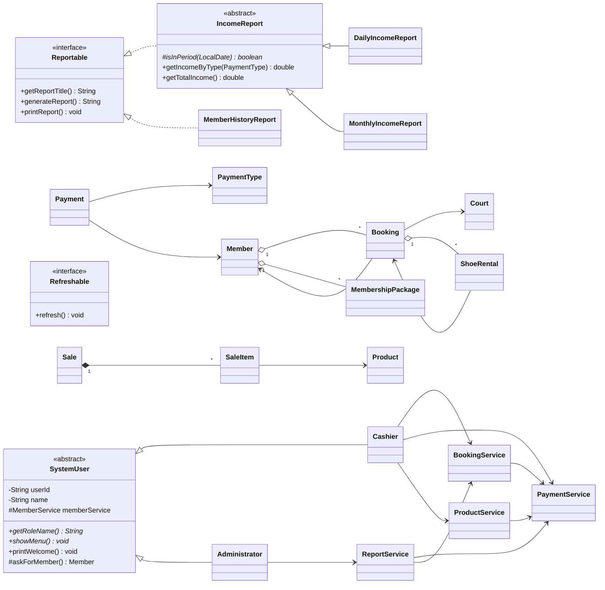
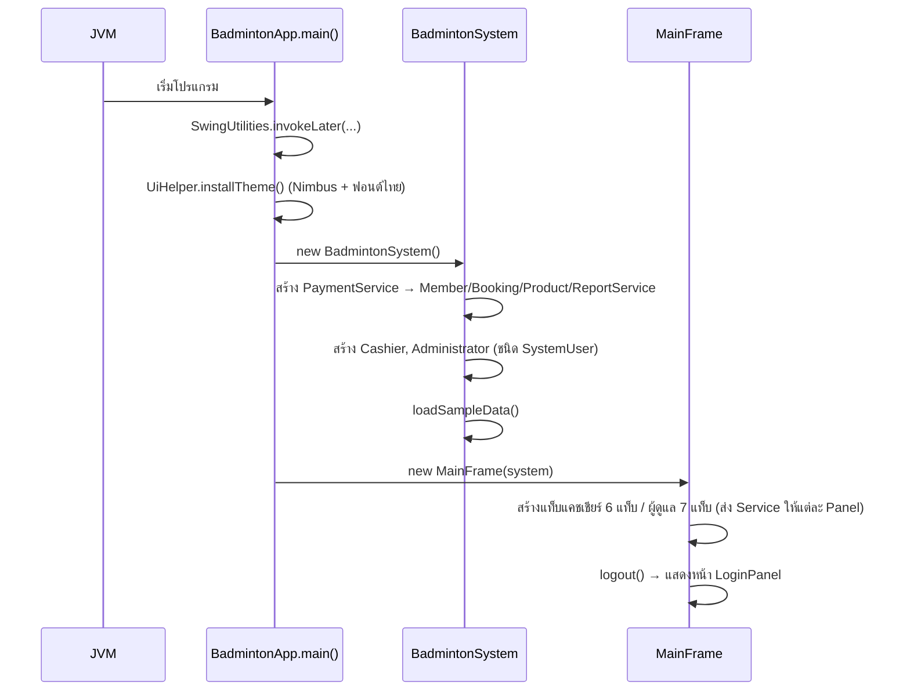
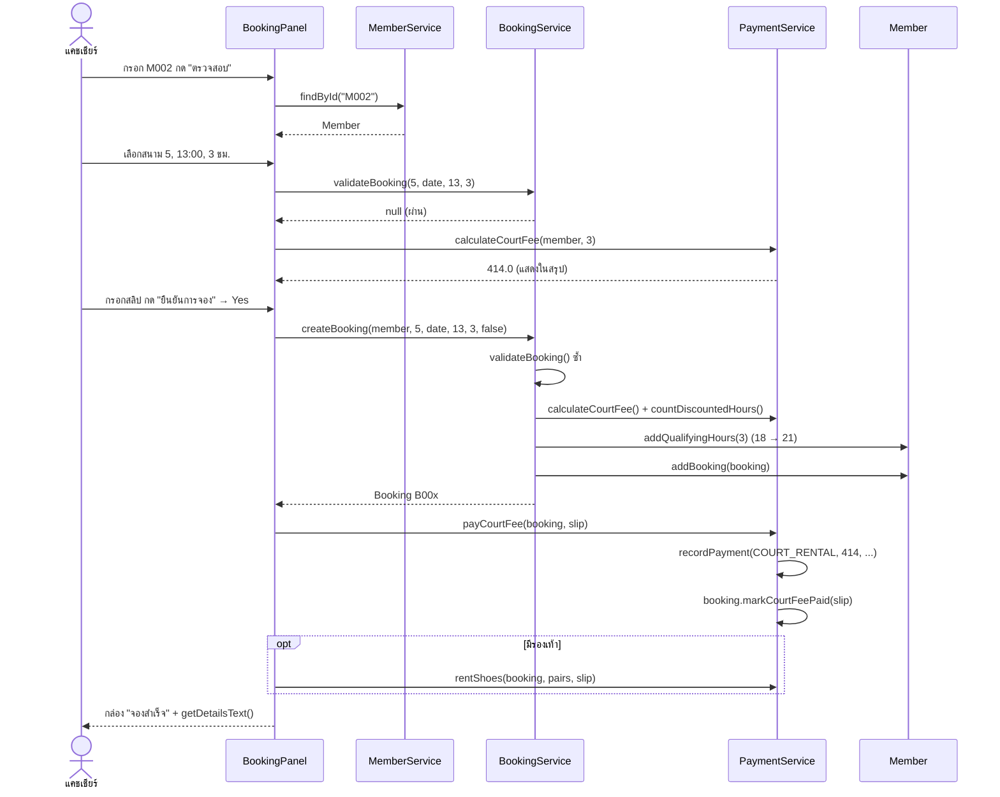
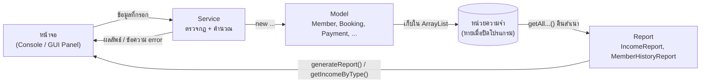

# เอกสารวิเคราะห์โปรแกรม: ระบบจองสนามแบดมินตัน (Java OOP)

> จัดทำเมื่อ 11 ตุลาคม 2026 จากซอร์สโค้ดในโฟลเดอร์ `badminton-booking-` (commit `da196b4`)
> เอกสารนี้ใช้สำหรับทำความเข้าใจและเตรียมนำเสนอเท่านั้น **ไม่ได้แก้ไขไฟล์โปรแกรมใด ๆ**

## วิธีอ่านเอกสารนี้

- ข้อความที่มีป้าย **[อ่านจากโค้ด]** คือข้อสรุปจากการอ่านซอร์สโค้ด
- ข้อความที่มีป้าย **[ทดสอบรันจริง]** คือผลที่ได้จากการคอมไพล์และรันโค้ดส่วนตรรกะ (model, service, report, user) ด้วย JDK 21 บนเครื่องทดสอบแยกต่างหาก โดยใช้สคริปต์ทดสอบที่เขียนขึ้นใหม่ และไม่ได้แตะไฟล์ในโปรเจกต์
- **ยังไม่ได้เปิดหน้าจอ GUI จริง** (สภาพแวดล้อมที่ใช้ทดสอบไม่มีหน้าจอ) ทุกคำอธิบายเรื่อง GUI จึงมาจากการอ่านโค้ด
- ชื่อคลาส เมธอด และตัวแปรคงไว้เป็นภาษาอังกฤษตามต้นฉบับ เพื่อให้เปิดไฟล์ตามได้ทันที
- ตำแหน่งไฟล์ทั้งหมดอยู่ใต้ `src/main/java/com/example/badminton/` (ย่อว่า `.../badminton/`)

---

## สารบัญ

1. [บทที่ 1: ภาพรวมโปรแกรม](#บทที่-1-ภาพรวมโปรแกรม)
2. [บทที่ 2: โครงสร้างโปรเจกต์](#บทที่-2-โครงสร้างโปรเจกต์)
3. [บทที่ 3: อธิบายคลาสและเมธอด](#บทที่-3-อธิบายคลาสและเมธอด)
4. [บทที่ 4: อธิบายการทำงานของระบบ](#บทที่-4-อธิบายการทำงานของระบบ)
5. [บทที่ 5: หลักการ OOP ในโปรแกรม](#บทที่-5-หลักการ-oop-ในโปรแกรม)
6. [บทที่ 6: การคำนวณและเงื่อนไขทางธุรกิจ](#บทที่-6-การคำนวณและเงื่อนไขทางธุรกิจ)
7. [บทที่ 7: ตารางตรวจสอบความครบถ้วน](#บทที่-7-ตารางตรวจสอบความครบถ้วน)
8. [บทที่ 8: คู่มือเตรียมตัวนำเสนอ](#บทที่-8-คู่มือเตรียมตัวนำเสนอ)
9. [บทที่ 9: คำถามที่อาจารย์อาจถาม](#บทที่-9-คำถามที่อาจารย์อาจถาม)
10. [บทที่ 10: สรุปสำหรับทบทวนก่อนนำเสนอ](#บทที่-10-สรุปสำหรับทบทวนก่อนนำเสนอ)

---

## บทที่ 1: ภาพรวมโปรแกรม

### 1.1 ชื่อและวัตถุประสงค์

- **ชื่อ:** ระบบจัดการการจองสนามแบดมินตัน (ชื่อหน้าต่างใน `MainFrame`: "ระบบจัดการการจองสนามแบดมินตัน")
- **วัตถุประสงค์:** ให้พนักงานแคชเชียร์บันทึกการจองสนาม 12 สนามให้สมาชิก รับเงินพร้อมเลขอ้างอิงสลิป ขายแพ็กเกจชั่วโมง ให้เช่ารองเท้า ขายอุปกรณ์ และให้ผู้ดูแลระบบดูประวัติการจองและรายงานรายได้

### 1.2 ปัญหาที่โปรแกรมแก้

| ปัญหาเดิม (ถ้าจดด้วยมือ) | สิ่งที่โปรแกรมทำแทน |
|---|---|
| จองซ้อนสนามเดียวกันเวลาเดียวกัน | `BookingService.validateBooking()` ตรวจการทับเวลาก่อนบันทึกทุกครั้ง |
| จองนอกเวลาทำการ | ตรวจเวลาเปิด-ปิดแยกวันธรรมดา/วันหยุดอัตโนมัติ |
| คิดราคาและส่วนลดผิด | `PaymentService.calculateCourtFee()` คำนวณให้ รวมส่วนลดชั่วโมงที่ 20 |
| ลืมหักชั่วโมงแพ็กเกจ | `Member.usePackageHours()` หักให้อัตโนมัติ และห้ามติดลบ |
| สรุปรายได้ยาก | `DailyIncomeReport` / `MonthlyIncomeReport` สรุปแยก 4 หมวด |

### 1.3 ผู้ใช้งานและความสามารถหลัก

| ผู้ใช้ | คลาสในโค้ด | ความสามารถ (Console = เมนูตัวเลข, GUI = แท็บ) |
|---|---|---|
| พนักงานแคชเชียร์ | `user/Cashier.java` | จองสนาม, ดูตารางสนาม, ค้นหาการจอง, ขาย/ตรวจแพ็กเกจ, เช่ารองเท้า, ขายอุปกรณ์, ดูข้อมูลสมาชิก |
| ผู้ดูแลระบบ | `user/Administrator.java` | ประวัติการจองของสมาชิก, รายงานรายได้รายวัน/รายเดือน, ดูการจองทั้งหมด, ดูรายการรับเงิน, ดูสมาชิก, จัดการสินค้า, จัดการวันหยุด |
| (ไม่ต้องเข้าสู่ระบบ) | `Main.registerMember()`, `gui/RegisterMemberDialog.java` | สมัครสมาชิก |

### 1.4 เทคโนโลยีที่ใช้ (อ้างอิงจากไฟล์จริง)

| รายการ | หลักฐาน |
|---|---|
| ภาษา Java ตั้งค่าคอมไพล์เป็น Java 25 | `pom.xml` → `<source>25</source>` `<target>25</target>` |
| เครื่องมือ build: Maven (มี Maven Wrapper) | `pom.xml`, `mvnw`, `mvnw.cmd`, `.mvn/wrapper/` |
| **GUI ใช้ Java Swing ไม่ใช่ JavaFX** | `module-info.java` มีแค่ `requires java.desktop;` และทุกหน้าจอ import `javax.swing.*` ไม่พบไฟล์ `.fxml` หรือ `.css` ในโปรเจกต์ |
| JUnit 5 ประกาศไว้ใน `pom.xml` แต่ **ไม่พบโฟลเดอร์ `src/test`** | ยังไม่มี unit test |
| ไม่มีฐานข้อมูล | ไม่พบไฟล์ SQL / JDBC ข้อมูลเก็บใน `ArrayList` ภายใน Service |
| IDE: IntelliJ IDEA | โฟลเดอร์ `.idea/` |

> **ข้อควรรู้ก่อนนำเสนอ:** ถ้าอาจารย์ถามว่า "ใช้ JavaFX ใช่ไหม" คำตอบตามโค้ดจริงคือ **ไม่ใช่ โปรแกรมใช้ Swing** README ของโปรเจกต์ระบุว่าไฟล์ตัวอย่าง JavaFX ที่ IntelliJ สร้างมาตอนแรกถูกลบออกแล้ว ถ้าวิชากำหนดให้ใช้ JavaFX ต้องยืนยันกับอาจารย์ก่อน

### 1.5 วิธีรันโปรแกรม (จาก README และโค้ด)

โปรแกรมมี 2 หน้าตาที่ใช้ตรรกะชุดเดียวกัน:

- **GUI:** รัน `gui/BadmintonApp.java` (`main` → สร้าง `BadmintonSystem` → เปิด `MainFrame`)
- **Console:** รัน `Main.java` (พิมพ์ตัวเลขเลือกเมนู)

ทุกครั้งที่เปิดโปรแกรม `BadmintonSystem.loadSampleData()` จะโหลดข้อมูลตัวอย่าง: สมาชิก M001–M003, สินค้า P01–P08, วันหยุดปี 2026, M002 มีชั่วโมงสะสม 18 ชม., M003 มีแพ็กเกจ 15 ชม.

---

## บทที่ 2: โครงสร้างโปรเจกต์

### 2.1 แผนผังโฟลเดอร์

```
badminton-booking-/
├── pom.xml                  ตั้งค่า Maven (Java 25, JUnit)
├── README.md                เอกสารของผู้พัฒนา
├── mvnw, mvnw.cmd, .mvn/    Maven Wrapper
├── .idea/                   ตั้งค่า IntelliJ (ไม่เกี่ยวกับการทำงานของโปรแกรม)
├── target/classes/          ไฟล์ .class ที่เคยคอมไพล์แล้ว (ผลลัพธ์ build ไม่ใช่ซอร์สโค้ด)
└── src/main/java/
    ├── module-info.java     ประกาศโมดูล ต้องใช้ java.desktop (Swing)
    └── com/example/badminton/
        ├── Main.java                 จุดเริ่มแบบ Console
        ├── BadmintonSystem.java      สร้าง Service + ผู้ใช้ + ข้อมูลตัวอย่าง
        ├── model/     (10 ไฟล์)      ข้อมูลหลัก
        ├── service/   (5 ไฟล์)       กฎทางธุรกิจ + เก็บข้อมูล
        ├── report/    (5 ไฟล์)       รายงาน (interface + abstract class)
        ├── user/      (3 ไฟล์)       ผู้ใช้ระบบ (abstract class + 2 คลาสลูก)
        ├── util/      (2 ไฟล์)       ตัวช่วยรับข้อมูล/จัดรูปแบบ
        └── gui/       (20 ไฟล์)      หน้าจอ Swing
            ├── (10 ไฟล์หลัก)  BadmintonApp, MainFrame, LoginPanel, ...
            ├── cashier/ (5)   BookingPanel, CourtSchedulePanel, PackagePanel, ShoeRentalPanel, SalesPanel
            └── admin/   (5)   IncomeReportPanel, MemberHistoryPanel, PaymentsPanel, ProductManagePanel, HolidayPanel
```

**สถิติ:** ไฟล์ Java 48 ไฟล์ (รวม `module-info.java`) รวม 5,532 บรรทัด ไฟล์ที่ยาวที่สุดคือ `Cashier.java` (423 บรรทัด) และ `BookingPanel.java` (414 บรรทัด)

### 2.2 การจัดกลุ่มไฟล์ตามหน้าที่

| กลุ่มหน้าที่ | ไฟล์/คลาสจริง |
|---|---|
| ส่วนแสดงผล UI (GUI) | `gui/*` ทั้งหมด |
| ส่วนแสดงผล UI (Console) | `Main`, เมธอด `showMenu()` ของ `Cashier` และ `Administrator`, `util/InputHelper` |
| ส่วนควบคุม/ประกอบระบบ | `BadmintonSystem`, `gui/MainFrame`, `gui/RoleTabbedPane` |
| ส่วนข้อมูล (Model) | `model/Member`, `Court`, `Booking`, `MembershipPackage`, `ShoeRental`, `Product`, `Sale`, `SaleItem`, `Payment`, `PaymentType` |
| ส่วนคำนวณราคาและส่วนลด | `service/PaymentService` (ค่าสนาม/ส่วนลด), `ShoeRental.calculateFee()`, `SaleItem.getTotalPrice()`, `Sale.getTotalAmount()` |
| ส่วนสมาชิก | `service/MemberService`, `model/Member` |
| ส่วนสิทธิ์ผู้ใช้งาน | `user/SystemUser`, `Cashier`, `Administrator`, `gui/MainFrame.login()` |
| ส่วนการจองสนาม | `service/BookingService`, `model/Booking`, `model/Court` |
| ส่วนสินค้าและบริการเช่า | `service/ProductService`, `model/Product`, `Sale`, `SaleItem`, `ShoeRental`, `PaymentService.rentShoes()` |
| ส่วนรายงาน | `service/ReportService`, `report/*` |
| ส่วนฐานข้อมูล | **ไม่มี** ข้อมูลอยู่ในหน่วยความจำ (`ArrayList`) ปิดโปรแกรมแล้วหาย |

### 2.3 รูปแบบสถาปัตยกรรม

จากโค้ดพบการแบ่งชั้น (layer) ชัดเจน 3 ชั้น ซึ่ง **ใกล้เคียงแนวคิด MVC แต่ไม่ใช่ MVC แบบเต็มรูป** (ไม่มีคลาสที่ทำหน้าที่ Controller แยกออกมา หน้าจอ GUI แต่ละหน้าทั้งแสดงผลและรับ event เอง):

```
[ ชั้นหน้าจอ ]      Console: Main + Cashier/Administrator.showMenu()   |   GUI: gui/*Panel
        │ เรียกเมธอด
        ▼
[ ชั้นบริการ ]      MemberService, BookingService, PaymentService, ProductService, ReportService
        │ สร้าง/แก้ไข
        ▼
[ ชั้นข้อมูล ]      Member, Booking, Court, Payment, Product, Sale, ... และ report/*
```

หลักฐาน: คอมเมนต์ใน `Cashier.java` บรรทัด 28–30 เขียนไว้ว่า Cashier "ไม่ได้คำนวณหรือเก็บข้อมูลเอง" และ `BookingPanel` เรียก `bookingService.validateBooking()`, `paymentService.calculateCourtFee()` แทนการคำนวณเอง กฎทางธุรกิจจึงอยู่ที่ Service ที่เดียว Console และ GUI ได้ผลเหมือนกัน

### 2.4 แผนภาพความสัมพันธ์ระหว่างคลาส



> หน้าจอ GUI ที่ `implements Refreshable` มี 11 คลาส: `BookingPanel`, `PackagePanel`, `ShoeRentalPanel`, `SalesPanel`, `BookingSearchPanel`, `MemberPanel`, `IncomeReportPanel`, `MemberHistoryPanel`, `PaymentsPanel`, `ProductManagePanel`, `HolidayPanel` (ไม่ได้วาดในแผนภาพเพื่อให้อ่านง่าย) — `CourtSchedulePanel` **ไม่ได้** implements Refreshable แต่มีเมธอด `reload()` ของตัวเอง

**ตารางสรุปการพึ่งพา (ใครเรียกใคร):**

| คลาส | ใช้งาน |
|---|---|
| `BadmintonSystem` | สร้าง `PaymentService` ก่อน แล้วส่งเข้า constructor ของ `BookingService`, `ProductService`, `ReportService` จากนั้นสร้าง `Cashier`, `Administrator` |
| `BookingService` | `PaymentService.calculateCourtFee()`, `countDiscountedHours()` |
| `ProductService` | `PaymentService.recordPayment()` |
| `ReportService` | `PaymentService.getAllPayments()`, `BookingService.getAllBookings()` |
| `MainFrame` | ส่ง Service แต่ละตัวให้หน้าจอ (Panel) แต่ละแท็บ |

---

## บทที่ 3: อธิบายคลาสและเมธอด

> คลาสสำคัญอธิบายครบ 9 หัวข้อตามโจทย์ ส่วนคลาสเล็กหรือคลาสช่วยแสดงผลอธิบายแบบย่อ
> ศัพท์ที่ใช้บ่อย: **field** = ตัวแปรที่เป็นข้อมูลของออบเจกต์, **constructor** = เมธอดพิเศษที่ทำงานตอนสร้างออบเจกต์ด้วย `new`, **getter/setter** = เมธอดอ่าน/แก้ค่า field

### 3.1 `model/Member.java` — คลาส `Member`

1. **หน้าที่หลัก:** แทน "สมาชิก 1 คน" เก็บข้อมูลส่วนตัว ชั่วโมงสะสมสำหรับส่วนลด แพ็กเกจที่ซื้อ และประวัติการจอง
2. **ข้อมูลที่เก็บ (fields):**

   | field | ชนิด | ความหมาย |
   |---|---|---|
   | `memberId` | `final String` | รหัสสมาชิก เช่น M001 (ห้ามเปลี่ยน) |
   | `fullName` | `String` | ชื่อ-นามสกุล |
   | `phoneNumber` | `String` | เบอร์โทร 9–10 หลัก |
   | `registerDate` | `final LocalDate` | วันที่สมัคร |
   | `qualifyingHours` | `int` | ชั่วโมงสะสมเพื่อคิดส่วนลด **นับเฉพาะชั่วโมงที่จ่ายเงินปกติ** |
   | `packages` | `List<MembershipPackage>` | แพ็กเกจที่ซื้อ (มีได้หลายแพ็กเกจ) |
   | `bookings` | `List<Booking>` | ประวัติการจอง |

3. **เมธอดสำคัญ:**

   | เมธอด | รับ | คืน | ทำอะไร |
   |---|---|---|---|
   | `setFullName(String)` | ชื่อ | - | ห้ามว่าง ถ้าว่างโยน `IllegalArgumentException` แล้ว `trim()` |
   | `setPhoneNumber(String)` | เบอร์ | - | ตรวจด้วย regex `\\d{9,10}` (ตัวเลข 9–10 หลัก) |
   | `addQualifyingHours(int)` | ชั่วโมง | - | เพิ่มชั่วโมงสะสม ต้องมากกว่า 0 |
   | `getRemainingPackageHours()` | - | `int` | รวมชั่วโมงคงเหลือจากทุกแพ็กเกจ |
   | `usePackageHours(int)` | ชั่วโมง | `boolean` | หักชั่วโมงแพ็กเกจ ไล่หักจากแพ็กเกจเก่าสุดก่อน คืน `false` ถ้าไม่พอ |
   | `getBookings()` / `getPackages()` | - | `List` | คืน **สำเนา** ของ List ป้องกันภายนอกแก้ List จริง |
   | `getInfoText()` / `printInfo()` | - | `String` / - | สร้างข้อความข้อมูลสมาชิก (ใช้ทั้ง GUI และ Console) |

4. **การทำงานภายใน `usePackageHours(hours)` ทีละขั้น:**
   1. ถ้า `hours <= 0` หรือมากกว่าชั่วโมงคงเหลือรวม → คืน `false` ทันที (ชั่วโมงจึงไม่ติดลบ)
   2. ตั้ง `hoursLeftToDeduct = hours`
   3. วนแพ็กเกจตามลำดับที่ซื้อ: หักจากแพ็กเกจนั้น `Math.min(คงเหลือของแพ็กเกจ, ที่ยังต้องหัก)`
   4. ลด `hoursLeftToDeduct` จนเป็น 0 แล้วหยุด คืน `true`

5. **ความสัมพันธ์:** มี `Booking` หลายรายการและ `MembershipPackage` หลายรายการ (Aggregation) ถูกสร้างโดย `MemberService.registerMember()` ถูกอ้างอิงโดย `Booking`, `Payment`, `Sale`
6. **แนวคิด OOP:** Encapsulation ชัดเจน — field เป็น `private` ทั้งหมด, `memberId` ไม่มี setter, constructor เรียก setter เพื่อให้ข้อมูลผ่านการตรวจสอบตั้งแต่สร้าง, getter ของ List คืนสำเนา ไม่มี Inheritance/Interface
7. **ตัวอย่างการทำงาน (ข้อมูลสมมติ):** สมาชิกมีแพ็กเกจ A เหลือ 3 ชม. และแพ็กเกจ B เหลือ 15 ชม. จอง 5 ชม. ด้วยแพ็กเกจ → A เหลือ 0, B เหลือ 13, รวมเหลือ 13
8. **จุดที่ควรระวัง:** ตรวจเบอร์โทรเฉพาะรูปแบบตัวเลข ไม่ได้ตรวจว่าขึ้นต้นด้วย 0 ส่วนการกันเบอร์ซ้ำอยู่ที่ `MemberService` ไม่ได้อยู่ใน `Member`

### 3.2 `model/Court.java` — คลาส `Court`

- **หน้าที่:** แทนสนาม 1 สนาม เก็บ `courtNumber` (`private final`) และค่าคงที่ `STANDARD_PRICE_PER_HOUR = 180.0` (`public static final` ใช้ร่วมกันทุกสนาม)
- **constructor:** ห้ามหมายเลข ≤ 0
- **ความสัมพันธ์:** `BookingService` สร้าง 12 ออบเจกต์ใน constructor (`for i = 1..12`) และ `Booking` อ้างอิงถึง
- **OOP:** Encapsulation (ไม่มี setter เพราะหมายเลขสนามไม่ควรเปลี่ยน), override `toString()`
- **ข้อสังเกต:** ทุกสนามราคาเท่ากัน จึงเก็บราคาเป็น `static` ไม่ใช่ field ของแต่ละสนาม

### 3.3 `model/Booking.java` — คลาส `Booking`

1. **หน้าที่หลัก:** แทน "การจองสนาม 1 รายการ" ตามข้อมูลที่โจทย์กำหนด
2. **ข้อมูลที่เก็บ:**

   | field | ความหมาย |
   |---|---|
   | `bookingId` | รหัส B001, B002, ... |
   | `member`, `court` | อ้างอิงออบเจกต์ `Member` และ `Court` |
   | `bookingDate`, `startTime`, `durationHours` | วันที่ เวลาเริ่ม และจำนวนชั่วโมง (เต็มชั่วโมง) |
   | `courtFee` | ค่าสนามที่คำนวณแล้ว (รวมส่วนลด, ใช้แพ็กเกจ = 0) |
   | `discountedHours` | จำนวนชั่วโมงที่ได้ส่วนลดในการจองนี้ |
   | `usedPackage` | `true` = จองด้วยชั่วโมงแพ็กเกจ |
   | `createdDate` | วันที่ทำรายการ (`LocalDate.now()`) |
   | `slipReference` | เลขอ้างอิงสลิป (เริ่มต้น `"-"`) |
   | `paymentStatus` | ข้อความสถานะ 1 ใน 3 ค่า: `STATUS_UNPAID`, `STATUS_PAID`, `STATUS_PACKAGE` |
   | `shoeRentals` | รายการเช่ารองเท้าที่ผูกกับการจองนี้ |

   field ส่วนใหญ่เป็น `final` (เปลี่ยนไม่ได้หลังจอง) มีเพียง `slipReference` และ `paymentStatus` ที่เปลี่ยนได้ผ่าน `markCourtFeePaid()`

3. **เมธอดสำคัญ:**
   - `getEndTime()` = `startTime.plusHours(durationHours)`
   - `overlapsWith(courtNo, date, start, end)` — ตรวจการทับเวลา (หัวใจของการกันจองซ้อน)
   - `markCourtFeePaid(slip)` — เปลี่ยนสถานะเป็นชำระแล้ว (เรียกโดย `PaymentService.payCourtFee()`)
   - `getShoeRentalFee()` — รวมค่าเช่ารองเท้าทุกรายการ
   - `getTotalAmount()` = `courtFee + getShoeRentalFee()`
   - `getDetailsText()` / `printDetails()` / `toString()` — ข้อความแสดงผล
4. **การทำงานภายใน `overlapsWith()`:**

   ```java
   if (court.getCourtNumber() != otherCourtNumber) return false;  // ต่างสนาม = ไม่ทับ
   if (!bookingDate.equals(otherDate)) return false;              // ต่างวัน = ไม่ทับ
   return startTime.isBefore(otherEnd) && otherStart.isBefore(getEndTime());
   ```

   บรรทัดสุดท้ายคือสูตรช่วงเวลาซ้อนกัน: ช่วง [A, B) กับ [C, D) ทับกันเมื่อ **A < D และ C < B**
5. **ความสัมพันธ์:** อ้างอิง `Member`, `Court`; เก็บ `ShoeRental` หลายรายการ; สร้างโดย `BookingService.createBooking()`
6. **OOP:** Encapsulation (field `private`, ส่วนใหญ่ `final`, `getShoeRentals()` คืนสำเนา), override `toString()`
7. **ตัวอย่าง (สมมติ):** การจองเดิมสนาม 5 เวลา 13:00–16:00
   - ขอ 14:00–15:00 สนาม 5 → 13:00 < 15:00 และ 14:00 < 16:00 → **ทับ**
   - ขอ 16:00–17:00 สนาม 5 → 16:00 < 16:00 เป็นเท็จ → **ไม่ทับ** (จบ 16:00 พอดี อีกคนเริ่ม 16:00 ได้)
   - ขอ 14:00–15:00 สนาม 6 → ต่างสนาม → **ไม่ทับ**
   - **[ทดสอบรันจริง]** ทั้ง 3 กรณีได้ผลตามนี้
8. **จุดที่ควรระวัง:** สถานะเก็บเป็น `String` ไม่ใช่ `enum` (พิมพ์ผิดได้ถ้าเพิ่มสถานะใหม่) และไม่มีสถานะ "ยกเลิก"

### 3.4 `model/MembershipPackage.java` — คลาส `MembershipPackage`

- **หน้าที่:** แพ็กเกจเหมาชั่วโมง 1 ครั้งที่ซื้อ ค่าคงที่ `PACKAGE_PRICE = 2600.0`, `PACKAGE_HOURS = 15`
- **fields:** `packageId`, `purchaseDate`, `totalHours` (=15), `remainingHours`
- **เมธอดสำคัญ `useHours(int hours)`:** ห้าม ≤ 0 และห้ามมากกว่า `remainingHours` (โยน exception) แล้วจึงลบ → **ชั่วโมงไม่มีทางติดลบ**
- **`getUsedHours()`** = `totalHours - remainingHours`
- **OOP:** Encapsulation — `remainingHours` แก้ได้ทางเดียวคือผ่าน `useHours()` ซึ่งมีการตรวจสอบ
- **ความสัมพันธ์:** สร้างโดย `PaymentService.sellPackage()` เก็บใน `Member.packages`
- **ข้อสังเกต:** ไม่มีวันหมดอายุของแพ็กเกจ (โจทย์ไม่ได้กำหนด)

### 3.5 `model/ShoeRental.java` — คลาส `ShoeRental`

- **หน้าที่:** การเช่ารองเท้า 1 ครั้ง ผูกกับการจอง 1 รายการ
- **ค่าคงที่:** `PRICE_PER_PAIR_PER_DAY = 50.0`, `MAX_PAIRS = 20`
- **fields:** `rentalId`, `booking`, `pairs`, `rentalDate` (= วันที่จองสนาม), `rentalDays`, `slipReference`
- **constructor:** ตรวจ `1 ≤ pairs ≤ 20` และ `rentalDays > 0`
- **เมธอด `static calculateFee(pairs, days)`** = `pairs × days × 50` เป็น `static` เพื่อให้คำนวณราคาให้ดูก่อนได้โดยยังไม่สร้างรายการเช่า (ใช้ใน `Cashier.bookCourt()` และ `BookingPanel.updatePreview()`)
- **ข้อสังเกต:** ใน `PaymentService.rentShoes()` ส่ง `rentalDays = 1` เสมอ เพราะสมมติว่าการจอง 1 รายการ = 1 วัน

### 3.6 `model/Product.java`, `SaleItem.java`, `Sale.java`

| คลาส | หน้าที่ | จุดสำคัญ |
|---|---|---|
| `Product` | สินค้า 1 ชนิด (`productId`, `name`, `unitPrice`) | `setUnitPrice()` ห้ามราคา ≤ 0 (Encapsulation) ชื่อห้ามว่าง |
| `SaleItem` | สินค้า 1 บรรทัดในใบเสร็จ | **เก็บราคาต่อหน่วยไว้ในตัวเองตอนสร้าง** ถ้าแก้ราคาสินค้าภายหลัง ยอดขายเก่าไม่เปลี่ยน; `getTotalPrice()` = `unitPrice × quantity`; quantity ต้อง > 0 |
| `Sale` | ใบเสร็จ 1 ใบ มีหลาย `SaleItem` | ต้องมีสินค้าอย่างน้อย 1 รายการ; คัดลอก List ไว้ (`new ArrayList<>(items)`); `member` เป็น `null` ได้ = ลูกค้าทั่วไป; `getTotalAmount()` รวมทุกบรรทัด |

**[ทดสอบรันจริง]** สร้าง `SaleItem` ของ P01 (1,200 บาท) แล้วเปลี่ยนราคา P01 เป็น 999 → `SaleItem.getUnitPrice()` ยังเป็น 1,200 ยืนยันว่าราคาในใบเสร็จไม่เปลี่ยนตาม

**ความสัมพันธ์ Sale–SaleItem เป็น Composition:** `SaleItem` เป็นส่วนหนึ่งของ `Sale` และไม่ถูกเก็บแยกที่อื่นใน Service

### 3.7 `model/Payment.java` และ `PaymentType.java`

- **`Payment`** = การรับเงินจริง 1 ครั้ง fields: `paymentId` (P0001...), `paymentDate`, `type`, `amount`, `member` (null ได้), `referenceId` (รหัสรายการต้นทาง เช่น B001, PK001, R001, S001), `slipReference`
  - constructor ห้าม `amount <= 0`
  - ทุก field เป็น `final` → บันทึกแล้วแก้ไม่ได้ (เหมาะกับข้อมูลการเงิน)
- **`PaymentType`** เป็น `enum` 4 ค่า: `COURT_RENTAL` (ค่าเช่าสนาม), `PACKAGE_SALE` (ขายแพ็กเกจชั่วโมง), `SHOE_RENTAL` (ค่าเช่ารองเท้า), `EQUIPMENT_SALE` (ขายอุปกรณ์แบดมินตัน) แต่ละค่ามี `thaiName` ผ่าน constructor ของ enum
  - **ทำไมใช้ enum:** จำกัดค่าได้แค่ 4 หมวด พิมพ์ผิดไม่ได้ และ `PaymentType.values()` ใช้วนสร้างรายงานทุกหมวดได้
- **หลักบัญชีของระบบ:** รายได้ทุกบาทในรายงานมาจาก `Payment` เท่านั้น และนับตาม **วันที่รับเงิน** ไม่ใช่วันที่ใช้สนาม

### 3.8 `service/MemberService.java` — คลาส `MemberService`

1. **หน้าที่:** สมัครและค้นหาสมาชิก
2. **fields:** `members` (`ArrayList<Member>`), `nextMemberNumber` (ตัวนับออกรหัส)
3. **เมธอด:**
   - `registerMember(fullName, phone)`: ตรวจเบอร์ซ้ำด้วย `findByPhone()` → สร้างรหัส `String.format("M%03d", nextMemberNumber)` → `new Member(...)` (ตรวจชื่อ/เบอร์) → เพิ่มใน List → เพิ่มตัวนับ **หลัง** สร้างสำเร็จ
   - `findById(id)` (ไม่สนตัวพิมพ์เล็กใหญ่, `trim()`), `findByPhone(phone)`, `searchByName(keyword)` (ค้นบางส่วนของชื่อ), `getAllMembers()` (คืนสำเนา)
4. **ทำไมรหัสไม่ซ้ำ:** ตัวนับเพิ่มขึ้นอย่างเดียว และเพิ่มเฉพาะเมื่อสมัครสำเร็จ ถ้าข้อมูลผิด constructor โยน exception ก่อนถึงบรรทัด `nextMemberNumber++` ตัวนับจึงไม่ข้ามเลข
5. **ตัวอย่าง:** มี M001–M003 แล้ว สมัครด้วยเบอร์ `abc` → exception ตัวนับยังเป็น 4 → สมัครใหม่ด้วยเบอร์ถูกได้ M004 (**[ทดสอบรันจริง]** ผ่าน Console)
6. **จุดที่ควรระวัง:** ไม่มีการแก้ไข/ลบสมาชิก

### 3.9 `service/BookingService.java` — คลาส `BookingService` (สำคัญมาก)

1. **หน้าที่หลัก:** จัดการสนามและการจองทั้งหมด: เวลาทำการ วันหยุด การตรวจสอบ การสร้างการจอง และการค้นหา
2. **ข้อมูลที่เก็บ:**

   | field | ความหมาย |
   |---|---|
   | `TOTAL_COURTS = 12` | `public static final` จำนวนสนาม |
   | `WEEKDAY_OPEN/CLOSE` = 13:00/21:00 | `private static final` |
   | `WEEKEND_OPEN/CLOSE` = 10:00/20:00 | `private static final` |
   | `courts` | สนาม 12 ออบเจกต์ |
   | `bookings` | การจองทั้งหมด |
   | `publicHolidays` | วันหยุดนักขัตฤกษ์ (`List<LocalDate>`) |
   | `paymentService` | ได้รับจาก constructor ใช้คำนวณค่าสนาม |
   | `nextBookingNumber` | ตัวนับออกรหัส B001... |

3. **เมธอดสำคัญ:**

   | เมธอด | หน้าที่ |
   |---|---|
   | `isWeekendOrHoliday(date)` | เสาร์ หรือ อาทิตย์ หรืออยู่ในรายการวันหยุด |
   | `getOpeningTime(date)` / `getClosingTime(date)` | เลือกเวลาตามชนิดของวัน |
   | `addPublicHoliday(date)` | เพิ่มวันหยุด (ซ้ำไม่ได้ คืน `false`) |
   | `isCourtAvailable(court, date, start, end)` | วนทุกการจอง ถ้า `overlapsWith()` สักรายการ → ไม่ว่าง |
   | `validateBooking(court, date, startHour, hours)` | ตรวจทุกเงื่อนไข คืนข้อความ error หรือ `null` ถ้าผ่าน |
   | `createBooking(member, court, date, startHour, hours, usePackage)` | สร้างและบันทึกการจอง |
   | `findById`, `searchByMemberId`, `searchByMemberName`, `searchByDate`, `getAllBookings` | ค้นหา |
   | `printCourtSchedule(date)` | พิมพ์ตารางสนามทาง Console |

4. **การทำงานภายใน `validateBooking()` (ตรวจตามลำดับ หยุดที่ข้อแรกที่ไม่ผ่าน):**
   1. หมายเลขสนามต้องมีจริง (1–12) — ใช้ `getCourt()` ถ้าได้ `null` แปลว่าไม่มี
   2. วันที่ต้องไม่เป็นอดีต `date.isBefore(LocalDate.now())`
   3. จำนวนชั่วโมง > 0
   4. `startHour >= ชั่วโมงเปิด` และ `startHour + hours <= ชั่วโมงปิด` (ตรวจเป็นตัวเลข int ก่อนสร้าง `LocalTime` เพื่อกันเวลาเกินเที่ยงคืนแล้ววนกลับ)
   5. สนามต้องว่าง `isCourtAvailable()`
   6. ผ่านทั้งหมด → คืน `null`

   **ทำไมคืน String แทน boolean:** เพื่อให้หน้าจอแสดง "เหตุผล" ที่จองไม่ได้เป็นภาษาไทยได้ทันที
5. **การทำงานภายใน `createBooking()`:**
   1. `member == null` → โยน exception ("เฉพาะสมาชิกเท่านั้นที่จองสนามได้")
   2. เรียก `validateBooking()` **อีกครั้ง** (กันข้อมูลเปลี่ยนระหว่างผู้ใช้กรอก)
   3. ถ้าใช้แพ็กเกจ: ตรวจชั่วโมงคงเหลือพอ ค่าสนาม = 0
      ถ้าจ่ายปกติ: `courtFee = paymentService.calculateCourtFee(member, hours)` และนับชั่วโมงที่ได้ส่วนลด
   4. สร้างรหัส `B%03d` และ `new Booking(...)`
   5. ใช้แพ็กเกจ → `member.usePackageHours(hours)` / จ่ายปกติ → `member.addQualifyingHours(hours)` (**ทำหลังคำนวณราคา** ส่วนลดจึงไม่คลาดเคลื่อน)
   6. เก็บลง `bookings` และ `member.addBooking()` แล้วเพิ่มตัวนับ
   7. คืน `Booking` (การรับเงินทำต่อโดย `PaymentService.payCourtFee()` ที่ผู้เรียกต้องเรียกเอง)
6. **ความสัมพันธ์:** ใช้ `PaymentService`; ถูกใช้โดย `Cashier`, `Administrator`, `ReportService`, `BookingPanel`, `CourtSchedulePanel`, `BookingSearchPanel`, `ShoeRentalPanel`, `HolidayPanel`
7. **OOP:** Encapsulation (List เป็น `private`, getter คืนสำเนา), Composition กับ `Court` (สนามถูกสร้างและเป็นเจ้าของโดย Service นี้), Dependency Injection แบบง่าย (รับ `PaymentService` ผ่าน constructor)
8. **ตัวอย่าง (วันที่ทดสอบ: อาทิตย์ 11 ต.ค. 2026)** **[ทดสอบรันจริง]**
   - จันทร์ 12 ต.ค. เริ่ม 10:00 → "อยู่นอกเวลาทำการ วันนี้เปิด 13:00 - 21:00"
   - จันทร์ 12 ต.ค. 20:00 จำนวน 2 ชม. → ปฏิเสธ (จบ 22:00 เกิน 21:00)
   - เสาร์ 17 ต.ค. 19:00 จำนวน 2 ชม. → ปฏิเสธ (จบ 21:00 เกิน 20:00)
   - อังคาร 13 ต.ค. (อยู่ในรายการวันหยุด) → เวลาเปิด 10:00–20:00
   - สนาม 13 → "หมายเลขสนามไม่ถูกต้อง"
9. **จุดที่ควรระวัง (ตรวจพบจริง):**
   - **จองวันนี้ในชั่วโมงที่ผ่านไปแล้วได้** — ข้อ 2 ตรวจแค่ "วันที่" ไม่ได้ตรวจ "เวลา" **[ทดสอบรันจริง]** ตอน 21:44 ของวันที่ 11 ต.ค. เรียก `validateBooking(1, วันนี้, 10, 1)` ได้ `null` (ผ่าน) ทั้งที่ 10:00 ผ่านไปแล้ว
   - เพิ่มวันหยุดภายหลังไม่ตรวจการจองเดิม **[ทดสอบรันจริง]** จองวันพุธ 14 ต.ค. เวลา 20:00–21:00 แล้วเพิ่ม 14 ต.ค. เป็นวันหยุด (ปิด 20:00) → การจองเดิมยังอยู่ทั้งที่อยู่นอกเวลาใหม่
   - ไม่มีเมธอดยกเลิก/แก้ไขการจอง และไม่มีการลบวันหยุด
   - การค้นหาวนทุกรายการ (linear search) เหมาะกับข้อมูลน้อย

### 3.10 `service/PaymentService.java` — คลาส `PaymentService` (สำคัญมาก)

1. **หน้าที่หลัก:** ทุกอย่างที่เกี่ยวกับเงิน — คำนวณค่าสนาม/ส่วนลด, บันทึกรับเงิน, ขายแพ็กเกจ, ให้เช่ารองเท้า
2. **ข้อมูลที่เก็บ:** `DISCOUNT_HOUR_INTERVAL = 20`, `DISCOUNT_PERCENT_TO_PAY = 30`, `payments`, `shoeRentals`, ตัวนับ `nextPaymentNumber`, `nextPackageNumber`, `nextRentalNumber`
3. **เมธอดสำคัญ:**

   | เมธอด | คืน | ทำอะไร |
   |---|---|---|
   | `isDiscountHour(n)` | `boolean` | `n % 20 == 0` (ชั่วโมงที่ 20, 40, 60, ...) |
   | `getDiscountedHourPrice()` | `double` | `180 × 30 / 100.0 = 54` |
   | `calculateCourtFee(member, hours)` | `double` | วนทีละชั่วโมง คิดราคาตามลำดับชั่วโมงสะสม (**แค่คำนวณ ไม่เปลี่ยนข้อมูล**) |
   | `countDiscountedHours(member, hours)` | `int` | นับชั่วโมงที่ได้ส่วนลด |
   | `recordPayment(type, amount, member, refId, slip)` | `Payment` | จุดเดียวที่สร้าง `Payment` ตรวจห้ามบันทึกซ้ำ |
   | `isAlreadyPaid(type, refId)` | `boolean` | มี Payment หมวดเดียวกันของรายการนี้แล้วหรือยัง |
   | `payCourtFee(booking, slip)` | `Payment` หรือ `null` | ใช้แพ็กเกจหรือค่าสนาม 0 → คืน `null` ไม่สร้างรายได้; ไม่เช่นนั้นบันทึกและ `markCourtFeePaid()` |
   | `sellPackage(member, slip)` | `MembershipPackage` | สร้างแพ็กเกจ PK%03d บันทึกรายได้ 2,600 ผูกกับสมาชิก |
   | `rentShoes(booking, pairs, slip)` | `ShoeRental` | สร้าง R%03d บันทึกรายได้ ผูกกับการจอง |

4. **การทำงานภายใน `calculateCourtFee()`:**

   ```java
   int hoursBefore = member.getQualifyingHours();
   for (int i = 1; i <= hours; i++) {
       int hourNumber = hoursBefore + i;          // ลำดับชั่วโมงสะสมของชั่วโมงนี้
       if (isDiscountHour(hourNumber)) total += getDiscountedHourPrice();  // 54
       else                            total += Court.STANDARD_PRICE_PER_HOUR; // 180
   }
   ```

5. **กลไกกันนับเงินซ้ำ:** `recordPayment()` เรียก `isAlreadyPaid(type, referenceId)` ก่อน ถ้าเคยบันทึกหมวดเดียวกันของรายการเดิมแล้ว → โยน exception **[ทดสอบรันจริง]** เรียก `payCourtFee()` ซ้ำกับ B004 ได้ข้อความ "รายการ B004 ถูกบันทึกรับเงินไปแล้ว (ห้ามบันทึกซ้ำ)"
6. **ความสัมพันธ์:** ถูกใช้โดย `BookingService`, `ProductService`, `ReportService`, `Cashier`, และหน้าจอ GUI หลายหน้า
7. **OOP:** Encapsulation, Abstraction (ผู้เรียกแค่เรียก `calculateCourtFee()` ไม่ต้องรู้สูตร), ใช้ค่าคงที่แทนตัวเลขลอย (magic number)
8. **ตัวอย่าง:** ดูบทที่ 6
9. **จุดที่ควรระวัง:** ใช้ `double` เก็บเงิน (ในระบบนี้ค่าเป็นจำนวนเต็มบาท จึงยังไม่เกิดปัญหาทศนิยม แต่ระบบจริงควรใช้ `BigDecimal`); `Payment.paymentDate` ใช้ `LocalDate.now()` บันทึกย้อนหลังไม่ได้

### 3.11 `service/ProductService.java` — คลาส `ProductService`

- **หน้าที่:** เก็บสินค้าและประวัติการขาย
- **เมธอด:** `addProduct(name, price)` ออกรหัส `P%02d`; `findProductById(id)`; `getAllProducts()`; `createSale(member, items, slip)` → สร้าง `Sale` (S%03d) → `paymentService.recordPayment(EQUIPMENT_SALE, ...)` → เก็บใน `sales`
- **ข้อสังเกต:** ไม่มีสต็อกสินค้า ไม่มีการลบสินค้า และไม่กันชื่อสินค้าซ้ำ (โจทย์ไม่ได้บังคับ)

### 3.12 `service/ReportService.java` — คลาส `ReportService`

- **หน้าที่:** โรงงานสร้างรายงาน (factory) และแสดงรายงาน
- **เมธอด:**
  - `createDailyReport(LocalDate)` → `new DailyIncomeReport(payments, bookings, date)` คืนเป็นชนิด `IncomeReport`
  - `createMonthlyReport(YearMonth)` → `new MonthlyIncomeReport(...)` คืนเป็นชนิด `IncomeReport`
  - `createMemberHistoryReport(Member)` → `new MemberHistoryReport(member)` คืนเป็นชนิด **`Reportable`**
  - `showReport(Reportable report)` → `report.printReport()` (ตัวอย่าง Polymorphism ผ่าน interface)
- **ข้อสังเกต:** รายงานได้ "สำเนา" ของ List ณ ตอนสร้าง (เพราะ `getAllPayments()` คืนสำเนา) ถ้ามีรายการใหม่ต้องสร้างรายงานใหม่ ซึ่งหน้าจอ GUI ทำทุกครั้งที่กดดูอยู่แล้ว

### 3.13 `report/Reportable.java` — interface `Reportable`

```java
public interface Reportable {
    String getReportTitle();      // ต้อง implement
    String generateReport();      // ต้อง implement
    default void printReport() {  // default method: เขียนเนื้อหาไว้ให้แล้ว
        System.out.println(generateReport());
    }
}
```

- **หน้าที่:** "สัญญา" ว่ารายงานทุกแบบต้องมีหัวรายงานและสร้างข้อความรายงานได้
- **default method** (มีตั้งแต่ Java 8) ทำให้ทุกคลาสที่ implements ได้ `printReport()` ฟรีโดยไม่ต้องเขียนซ้ำ
- **คลาสที่ implements:** `IncomeReport` (abstract) และ `MemberHistoryReport`

### 3.14 `report/IncomeReport.java` — abstract class `IncomeReport`

1. **หน้าที่:** แม่แบบรายงานรายได้ ใช้ร่วมกันระหว่างรายวันและรายเดือน
2. **fields:** `payments`, `bookings` (`private final`)
3. **เมธอด:**
   - `protected abstract boolean isInPeriod(LocalDate date)` — **คลาสลูกต้องเขียนเอง**
   - `getIncomeByType(type)` — รวม `amount` ของ Payment ที่หมวดตรงและ `isInPeriod(paymentDate)`
   - `getTotalIncome()`, `getTransactionCount()`
   - `getPackageHoursUsed()` — รวมชั่วโมงของการจองแบบใช้แพ็กเกจที่ `createdDate` อยู่ในช่วง (แสดงข้อมูล ไม่ใช่รายได้)
   - `generateReport()` — วน `PaymentType.values()` พิมพ์ยอดทุกหมวด + รวม + จำนวนรายการ
4. **การทำงาน (Template Method pattern):** `generateReport()` เขียนครั้งเดียวในคลาสแม่ แต่เรียก `isInPeriod()` และ `getReportTitle()` ซึ่งคลาสลูก override → รูปแบบรายงานเหมือนกัน ต่างแค่ช่วงเวลาและหัวรายงาน
5. **constructor เป็น `protected`** และคลาสเป็น `abstract` → `new IncomeReport(...)` ไม่ได้ ต้องสร้างผ่านคลาสลูก
6. **ข้อสังเกต:** `IncomeReport` implements `Reportable` แต่ **ไม่ได้** เขียน `getReportTitle()` เอง (ปล่อยให้คลาสลูกเขียน) ซึ่งทำได้เพราะเป็น abstract class

### 3.15 `report/DailyIncomeReport.java` และ `MonthlyIncomeReport.java`

| | `DailyIncomeReport` | `MonthlyIncomeReport` |
|---|---|---|
| สืบทอด | `extends IncomeReport` | `extends IncomeReport` |
| field ของตัวเอง | `LocalDate reportDate` | `YearMonth reportMonth` |
| constructor | `super(payments, bookings)` แล้วเก็บวันที่ | `super(payments, bookings)` แล้วเก็บเดือน |
| `isInPeriod(date)` (override) | `date.equals(reportDate)` | `YearMonth.from(date).equals(reportMonth)` |
| `getReportTitle()` (override) | "รายงานรายได้ประจำวันที่ ..." | "รายงานรายได้ประจำเดือน ... (พ.ศ. ...)" |

แต่ละคลาสยาวเพียง ~35 บรรทัด เพราะส่วนที่เหลือได้จากคลาสแม่ → ตัวอย่างประโยชน์ของ Inheritance ที่เห็นภาพชัด

### 3.16 `report/MemberHistoryReport.java`

- `implements Reportable` โดยตรง (ไม่ได้สืบทอด `IncomeReport` เพราะไม่ใช่รายงานรายได้)
- `generateReport()` แสดงทุกการจองของสมาชิก: รหัส วันที่ สนาม เวลา ชั่วโมง ค่าสนาม (หรือ "ใช้แพ็กเกจ x ชม.") ค่ารองเท้า ยอดรวม แล้วสรุปจำนวนการจอง ชั่วโมงรวม ยอดชำระรวม ชั่วโมงสะสม และ **ชั่วโมงถัดไปที่จะได้ส่วนลด** ด้วยสูตร `(qualifying / 20 + 1) × 20`
- **ตัวอย่าง [ทดสอบรันจริง]:** M002 สะสม 21 ชม. → ชั่วโมงส่วนลดถัดไป = (21/20 + 1) × 20 = (1 + 1) × 20 = 40 "อีก 19 ชั่วโมง"

### 3.17 `user/SystemUser.java` — abstract class `SystemUser`

1. **หน้าที่:** แม่แบบของพนักงานทุกประเภท
2. **fields:** `userId`, `name` (`private final`), `memberService` (**`protected final`** ให้คลาสลูกใช้ได้)
3. **เมธอด:**
   - `public abstract String getRoleName()` และ `public abstract void showMenu()` — คลาสลูกต้องเขียน
   - `printWelcome()` — พฤติกรรมร่วม เรียก `getRoleName()` (ได้ค่าต่างกันตามคลาสลูก)
   - `protected Member askForMember()` — ถามรหัสสมาชิกทาง Console แล้วค้นหา (ใช้ร่วมทั้งสองบทบาท)
   - `protected void printSection(title)` — พิมพ์หัวข้อเมนูย่อย
4. **constructor `protected`** — เรียกได้จากคลาสลูกผ่าน `super(...)`
5. **ข้อสังเกต:** เมธอด `showMenu()` และ `askForMember()` ทำงานแบบ Console (`System.out`, `InputHelper`) ฝั่ง GUI ใช้เพียง `getRoleName()`, `getName()`, `getUserId()` และชนิดของออบเจกต์

### 3.18 `user/Cashier.java` — คลาส `Cashier`

1. **หน้าที่:** พนักงานแคชเชียร์ (เมนู Console 8 ข้อ + 0 กลับ)
2. **fields เพิ่ม:** `bookingService`, `paymentService`, `productService` (`private final`)
3. **constructor:** `super(userId, name, memberService)` แล้วเก็บ Service ที่เหลือ
4. **เมธอด (override):** `getRoleName()` คืน "พนักงานแคชเชียร์", `showMenu()` วนแสดงเมนูและใช้ `switch` แบบลูกศร (`case 1 -> bookCourt();`)
5. **เมธอด private ของแต่ละเมนู:** `bookCourt()`, `viewCourtSchedule()`, `searchBooking()`, `printBookingList()`, `buyPackage()`, `checkPackageHours()`, `rentShoes()`, `sellEquipment()`, `viewMemberInfo()`
6. **ลำดับการทำงานของ `bookCourt()`:** ดูบทที่ 4 สถานการณ์ที่ 3–6
7. **OOP:** Inheritance (`extends SystemUser`), Method Overriding (`@Override` 2 เมธอด), ใช้ `protected` member ของคลาสแม่ (`memberService`, `askForMember()`)
8. **จุดที่ควรระวัง:** คลาสนี้ทำงานเฉพาะใน Console ฝั่ง GUI **ไม่ได้เรียกเมธอดของ Cashier** แต่หน้าจอ GUI เรียก Service โดยตรง (ตรรกะยังเหมือนกันเพราะอยู่ใน Service)

### 3.19 `user/Administrator.java` — คลาส `Administrator`

- `extends SystemUser`, fields เพิ่ม: `bookingService`, `paymentService`, `productService`, `reportService`
- override `getRoleName()` → "ผู้ดูแลระบบ" และ `showMenu()` (เมนู 8 ข้อ + 0)
- เมธอดเมนู: `viewMemberHistory()`, `viewDailyReport()`, `viewMonthlyReport()`, `viewAllBookings()`, `viewAllPayments()`, `viewAllMembers()`, `manageProducts()`, `manageHolidays()`
- **ตัวอย่าง Polymorphism:** ใน `viewDailyReport()` เขียน `Reportable report = reportService.createDailyReport(date);` → ตัวแปรชนิด interface เก็บออบเจกต์ `DailyIncomeReport` แล้วส่งให้ `reportService.showReport(report)`

### 3.20 `BadmintonSystem.java` และ `Main.java`

- **`BadmintonSystem`** เป็นจุดประกอบระบบ (composition root):
  1. สร้าง `PaymentService` ก่อน (ตัวอื่นต้องใช้)
  2. สร้าง `MemberService`, `BookingService(paymentService)`, `ProductService(paymentService)`, `ReportService(paymentService, bookingService)`
  3. สร้าง `cashier = new Cashier("C001", "สมหญิง ขยันขาย", ...)` และ `administrator = new Administrator("A001", "สมศักดิ์ ดูแลดี", ...)` โดย **ประกาศชนิดเป็น `SystemUser`**
  4. `loadSampleData()`: วันหยุด 21 วัน (2026–2027), สมาชิก 3 คน, สินค้า 8 รายการ, M002 จองสนาม 12 จำนวน 3 ครั้ง × 6 ชม. (วันที่ +7, +8, +9 จากวันนี้) และจ่ายเงิน, M003 ซื้อแพ็กเกจ
- **`Main`** (Console): สร้าง `BadmintonSystem` → วนเมนูหลัก 4 ข้อ → `openUserMenu(SystemUser user)` เรียก `user.showMenu()`

**[ทดสอบรันจริง]** หลังโหลดข้อมูลตัวอย่าง: M002 ชั่วโมงสะสม 18, มีการจอง 3 รายการ (B001–B003), M003 แพ็กเกจคงเหลือ 15, รายได้ของวันที่เปิดโปรแกรม = 5,840 บาท (ค่าสนาม 3,240 + แพ็กเกจ 2,600)

### 3.21 `util/InputHelper.java` และ `util/FormatHelper.java`

| คลาส | หน้าที่ | จุดน่าสนใจ |
|---|---|---|
| `InputHelper` | รับข้อมูลจากคีย์บอร์ด (Console) | ทุกเมธอดเป็น `static`, ใช้ `Scanner` ตัวเดียวทั้งโปรแกรม, วนถามซ้ำจนกรอกถูก (`try/catch NumberFormatException`, `DateTimeParseException`), แปลงปี พ.ศ. (≥ 2400) เป็น ค.ศ. อัตโนมัติ, `readLine()` จบโปรแกรมอย่างสุภาพถ้าไม่มี input แล้ว |
| `FormatHelper` | จัดรูปแบบแสดงผล | ชื่อวัน/เดือนภาษาไทยด้วย array, `money()` แสดง `%,.2f บาท`, `formatYearMonth()` แสดง พ.ศ. ด้วย |

### 3.22 คลาสฝั่ง GUI (แบบย่อ)

| ไฟล์ | สืบทอด/implements | หน้าที่ |
|---|---|---|
| `gui/BadmintonApp` | - | `main()` ใช้ `SwingUtilities.invokeLater()` เพื่อสร้างหน้าจอบน Event Dispatch Thread → `UiHelper.installTheme()` → `new BadmintonSystem()` → `new MainFrame(system)` |
| `gui/MainFrame` | `extends JFrame` | หน้าต่างหลัก แถบหัว + `CardLayout` สลับ 3 หน้า: login / cashier / admin; สร้างแท็บแคชเชียร์ 6 แท็บ, ผู้ดูแล 7 แท็บ; `login(SystemUser)` / `logout()` |
| `gui/LoginPanel` | `extends JPanel` | ปุ่ม 4 ปุ่ม: เข้าสู่ระบบแคชเชียร์, ผู้ดูแลระบบ, สมัครสมาชิก, ออกจากโปรแกรม |
| `gui/RegisterMemberDialog` | `extends JDialog` (modal) | ฟอร์มสมัครสมาชิก เรียก `MemberService.registerMember()` แสดง error สีแดงโดยไม่ปิดหน้าต่าง |
| `gui/RoleTabbedPane` | `extends JTabbedPane` | เมื่อเปลี่ยนแท็บ ถ้าแท็บนั้นเป็น `Refreshable` ให้เรียก `refresh()` |
| `gui/Refreshable` | interface | เมธอดเดียว `refresh()` |
| `gui/UiHelper` | `final class` + constructor `private` | สี ฟอนต์ไทย ปุ่ม ตาราง (อ่านอย่างเดียว) กล่องข้อความ `showError/showInfo/showText/confirm` |
| `gui/DateField` | `extends JPanel` | ช่องวันที่ + ปุ่ม `<` `>` "วันนี้" แจ้งผู้ฟังผ่าน `addChangeListener(Runnable)` แปลง พ.ศ. ได้ |
| `gui/BookingSearchPanel` | `JPanel` + `Refreshable` | ค้นหาการจอง 5 แบบ (ใช้ทั้งแคชเชียร์ และผู้ดูแลในโหมด "แสดงทั้งหมด") |
| `gui/MemberPanel` | `JPanel` + `Refreshable` | ตารางสมาชิก กรองทันทีที่พิมพ์ (`DocumentListener`) ปุ่มสมัครสมาชิก |
| `gui/cashier/BookingPanel` | `JPanel` + `Refreshable` | ฟอร์มจองสนาม + สรุปราคาแบบอัปเดตทันที (หัวใจของ GUI) |
| `gui/cashier/CourtSchedulePanel` | `extends JPanel` | ตาราง 12 สนาม × ชั่วโมง 10:00–20:00 (11 คอลัมน์) ระบายสีตามสถานะ คลิกเพื่อเลือกสนาม/เวลา มี inner class `ScheduleTableModel`, `SlotRenderer`, `ColorSquareIcon` |
| `gui/cashier/PackagePanel` | `JPanel` + `Refreshable` | ตรวจชั่วโมงแพ็กเกจและขายแพ็กเกจ |
| `gui/cashier/ShoeRentalPanel` | `JPanel` + `Refreshable` | เช่ารองเท้าเพิ่มให้การจองที่มีอยู่ + ตารางประวัติการเช่า |
| `gui/cashier/SalesPanel` | `JPanel` + `Refreshable` | รายการสินค้า + ตะกร้า + ยืนยันการขาย |
| `gui/admin/IncomeReportPanel` | `JPanel` + `Refreshable` | รายงานรายวัน/รายเดือน แสดงตาราง 4 หมวด + สัดส่วน % |
| `gui/admin/MemberHistoryPanel` | `JPanel` + `Refreshable` | เลือกสมาชิกจาก combo แสดง `MemberHistoryReport` |
| `gui/admin/PaymentsPanel` | `JPanel` + `Refreshable` | ตาราง Payment ทุกรายการ + ยอดรวม |
| `gui/admin/ProductManagePanel` | `JPanel` + `Refreshable` | เพิ่มสินค้าและแก้ราคา |
| `gui/admin/HolidayPanel` | `JPanel` + `Refreshable` | ดูและเพิ่มวันหยุด |

---

## บทที่ 4: อธิบายการทำงานของระบบ

### 4.1 ลำดับการเริ่มโปรแกรม (GUI)



### 4.2 หน้าจอ GUI และ Event Handlers

| หน้าจอ (แท็บ) | ใช้แสดง/รับข้อมูล | ปุ่ม/การกระทำ → เมธอดที่ถูกเรียก |
|---|---|---|
| **LoginPanel** | - | "เข้าสู่ระบบพนักงานแคชเชียร์" → `frame.login(system.getCashier())`; "ผู้ดูแลระบบ" → `frame.login(system.getAdministrator())`; "สมัครสมาชิก" → `RegisterMemberDialog.showDialog()`; "ออกจากโปรแกรม" → `frame.dispose()` |
| **RegisterMemberDialog** | ชื่อ, เบอร์โทร | "สมัครสมาชิก" หรือกด Enter ที่ช่องเบอร์ → `register()` → `memberService.registerMember()` |
| แคชเชียร์ **จองสนาม** (`BookingPanel`) | วันที่, รหัสสมาชิก, สนาม, เวลาเริ่ม, ชั่วโมง, ใช้แพ็กเกจ, รองเท้า, สลิป | "ตรวจสอบ" → `lookupMember()`; คลิกตาราง → `onSlotClicked()`; เปลี่ยนค่าใด ๆ → `updatePreview()`; "ยืนยันการจอง" → `confirmBooking()`; "ล้างฟอร์ม" → `clearForm()` |
| แคชเชียร์ **ค้นหาการจอง** (`BookingSearchPanel`) | ประเภทค้นหา + คำค้น | "ค้นหา" → `search(true)`; คลิกแถว → แสดง `getDetailsText()` |
| แคชเชียร์ **แพ็กเกจชั่วโมง** (`PackagePanel`) | รหัสสมาชิก, สลิป | "ตรวจสอบ" → `lookupMember()`; "ซื้อแพ็กเกจ" → `buyPackage()` |
| แคชเชียร์ **เช่ารองเท้า** (`ShoeRentalPanel`) | รหัสการจอง, จำนวนคู่, สลิป | "ค้นหา" → `lookupBooking()`; "ยืนยันการเช่า" → `rentShoes()` |
| แคชเชียร์ **ขายอุปกรณ์** (`SalesPanel`) | เลือกสินค้า, จำนวน, รหัสสมาชิก (ไม่บังคับ), สลิป | "เพิ่มลงตะกร้า" / ดับเบิลคลิก → `addToCart()`; "ลบรายการที่เลือก" → `removeSelected()`; "ยืนยันการขาย" → `confirmSale()` |
| ทั้งสองบทบาท **สมาชิก** (`MemberPanel`) | คำค้น | พิมพ์ → `refresh()` กรองทันที; "+ สมัครสมาชิกใหม่" → `registerMember()` |
| ผู้ดูแล **รายงานรายได้** (`IncomeReportPanel`) | รายวัน (วันที่) / รายเดือน (เดือน+ปี) | เปลี่ยน radio → `updateInputs()`; "แสดงรายงาน" หรือเปลี่ยนวันที่ → `showReport()` |
| ผู้ดูแล **ประวัติการจองของสมาชิก** | เลือกสมาชิก | เลือก combo / "แสดงประวัติ" → `showHistory()` |
| ผู้ดูแล **การจองทั้งหมด** | (เริ่มที่โหมดแสดงทั้งหมด) | เหมือน BookingSearchPanel |
| ผู้ดูแล **รายการรับเงิน** | - | แสดงอย่างเดียว (`refresh()`) |
| ผู้ดูแล **จัดการสินค้า** | ชื่อ, ราคา, ราคาใหม่ | "เพิ่มสินค้า" → `addProduct()`; "แก้ราคาสินค้าที่เลือก" → `changePrice()` |
| ผู้ดูแล **วันหยุดนักขัตฤกษ์** | วันที่ | "เพิ่มวันหยุด" → `addHoliday()` |
| แถบหัว | - | "ออกจากระบบ" → `MainFrame.logout()` |

**กลไกโหลดข้อมูลใหม่อัตโนมัติ:** `RoleTabbedPane` ลงทะเบียน `addChangeListener(e -> refreshSelectedTab())` เมื่อผู้ใช้เปลี่ยนแท็บ ถ้าหน้าจอของแท็บนั้นเป็น `Refreshable` จะเรียก `refresh()` ทำให้เช่น จองสนามแล้วไปแท็บ "ค้นหาการจอง" จะเห็นรายการใหม่ทันที

**FXML / Controller / CSS:** ไม่มีในโปรเจกต์นี้ เพราะใช้ Swing หน้าจอสร้างด้วยโค้ด Java ทั้งหมด (layout เช่น `BorderLayout`, `GridBagLayout`, `CardLayout`) และการตกแต่งทำผ่าน `UiHelper` (สี, ฟอนต์, Look and Feel "Nimbus") แทน CSS

### 4.3 สถานการณ์การใช้งานตามโจทย์

> ตัวอย่างทุกข้อเป็น **ข้อมูลสมมติ** ที่สอดคล้องกับข้อมูลตัวอย่างในโปรแกรม (วันที่ทดสอบ: อาทิตย์ 11 ต.ค. 2026)

#### สถานการณ์ที่ 1: สมัครสมาชิก

- **จุดเริ่มต้น:** GUI กด "สมัครสมาชิก" ที่หน้าแรก หรือ "+ สมัครสมาชิกใหม่" ในแท็บสมาชิก / Console เมนูหลักข้อ 3
- **ลำดับการทำงาน:**
  1. `RegisterMemberDialog.register()` (GUI) หรือ `Main.registerMember()` (Console)
  2. เรียก `MemberService.registerMember(name, phone)` → ตรวจเบอร์ซ้ำ `findByPhone()`
  3. สร้างรหัส `M%03d` → `new Member(...)` ซึ่งเรียก `setFullName()` (ห้ามว่าง) และ `setPhoneNumber()` (9–10 หลัก)
  4. เพิ่มใน `members` และเพิ่มตัวนับ
  5. บันทึกใน `ArrayList` ของ `MemberService` (หน่วยความจำ)
  6. GUI แสดงกล่อง "สมัครสมาชิกสำเร็จ" พร้อม `getInfoText()` / Console พิมพ์รหัสและข้อมูล ถ้าผิด GUI แสดงข้อความสีแดง Console ให้กรอกเบอร์ใหม่
- **ตัวอย่าง:** ชื่อ "ทดสอบ ระบบ" เบอร์ `abc` → "เบอร์โทรศัพท์ต้องเป็นตัวเลข 9-10 หลัก" → เบอร์ `0811111111` → ได้ M004 **[ทดสอบรันจริง ผ่าน Console]**
- **หลักฐาน:** `MemberService.registerMember()`, `Member.setPhoneNumber()`, `RegisterMemberDialog.register()`, `Main.registerMember()`

#### สถานการณ์ที่ 2: เข้าสู่ระบบและแยกสิทธิ์ผู้ใช้งาน

- **จุดเริ่มต้น:** GUI กดปุ่มบทบาทที่ `LoginPanel` / Console เมนูหลักข้อ 1 หรือ 2
- **ลำดับการทำงาน (GUI):**
  1. `LoginPanel` เรียก `frame.login(system.getCashier())` หรือ `frame.login(system.getAdministrator())`
  2. `MainFrame.login(SystemUser user)` แสดงชื่อด้วย `user.getRoleName()` (ได้ข้อความต่างกันตามคลาสจริง)
  3. ตรวจ `user instanceof Cashier` → `cardLayout.show(cardPanel, "cashier")` ไม่ใช่ → `"admin"`
  4. เลือกแท็บแรกและ `refreshSelectedTab()`
- **ลำดับการทำงาน (Console):** `Main.openUserMenu(SystemUser user)` → `user.showMenu()` → ได้เมนูของ `Cashier` หรือ `Administrator` ตามชนิดจริง
- **การแยกสิทธิ์จริงในโค้ด:** แยกโดย "ชุดเมนู/แท็บที่แต่ละบทบาทเห็น" แคชเชียร์ไม่มีแท็บรายงานรายได้ ผู้ดูแลไม่มีแท็บจองสนาม
- **ข้อจำกัด:** **ไม่มีรหัสผ่านหรือการยืนยันตัวตน** ใครก็กดเลือกบทบาทได้ (ผู้พัฒนาเขียนไว้ใน `LoginPanel` ว่า "จำลองการเข้าสู่ระบบเพื่อการเรียนรู้") มีผู้ใช้ตายตัว 1 คนต่อบทบาท (C001, A001)
- **หลักฐาน:** `MainFrame.login()`, `LoginPanel` constructor, `Main.openUserMenu()`, `BadmintonSystem` constructor

#### สถานการณ์ที่ 3: ตรวจสอบสนามและเวลาที่ต้องการจอง

- **จุดเริ่มต้น:** GUI แท็บ "จองสนาม" เลือกวันที่ (ค่าเริ่มต้น = พรุ่งนี้) / Console แคชเชียร์เมนู 2 หรือระหว่างเมนู 1
- **ลำดับการทำงาน (GUI):**
  1. เปลี่ยนวันที่ → `DateField.fireChanged()` → `BookingPanel.onDateChanged()`
  2. อ่านเวลาเปิด-ปิดจาก `bookingService.getOpeningTime/ClosingTime(date)` แสดงที่ป้ายด้านบน และเติมรายการเวลาเริ่มใน combo เฉพาะชั่วโมงที่เปิด
  3. `schedulePanel.showDate(date)` → `ScheduleTableModel.reload()` ดึง `bookingService.searchByDate(date)` มาวางลงช่องตาราง
  4. `SlotRenderer` ระบายสี: เขียวอ่อน=ว่าง, แดงอ่อน=จองแล้ว, ส้ม=จองด้วยแพ็กเกจ, เทา=ปิด, เหลือง=ช่วงที่เลือก, แดงเข้ม=ช่วงที่เลือกชน/นอกเวลา
  5. คลิกช่อง → `onSlotClicked(court, hour)` ตั้งค่า combo สนาม/เวลา → `updatePreview()` → `bookingService.validateBooking()` ถ้าไม่ผ่านแสดงเหตุผลสีแดงและปิดปุ่มยืนยัน
- **หลักฐาน:** `BookingPanel.onDateChanged()`, `updatePreview()`, `CourtSchedulePanel.ScheduleTableModel.reload()`, `BookingService.validateBooking()`, `Cashier.viewCourtSchedule()` → `BookingService.printCourtSchedule()`

#### สถานการณ์ที่ 4: บันทึกข้อมูลการจอง (GUI)



- **ลำดับการทำงานใน `BookingPanel.confirmBooking()`:**
  1. อ่านวันที่ (`dateField.getDate()` ถ้ารูปแบบผิดแสดง error)
  2. คำนวณยอดรวม ถ้า `total > 0` และช่องสลิปว่าง → แจ้ง "กรุณากรอกเลขอ้างอิงสลิป หรือพิมพ์ CASH"; ถ้า `total == 0` ตั้งสลิปเป็น `"-"`
  3. ถามยืนยันด้วย `UiHelper.confirm()`
  4. `bookingService.createBooking(...)` → `paymentService.payCourtFee(...)` → (ถ้ามีรองเท้า) `paymentService.rentShoes(...)`
  5. แสดงรายละเอียด ล้างช่องสลิป/รองเท้า `schedulePanel.reload()` และ `lookupMember()` เพื่ออัปเดตชั่วโมงสะสม
  6. ถ้าเกิด `IllegalArgumentException` → `UiHelper.showError()`
- **เส้นทาง Console:** `Cashier.bookCourt()` ทำขั้นตอนเดียวกัน (รับค่าด้วย `InputHelper`, จำกัดเวลาเริ่ม 0–23 และชั่วโมง 1–12)
- **บันทึกที่ใด:** `BookingService.bookings`, `Member.bookings`, `PaymentService.payments` (ทั้งหมดอยู่ในหน่วยความจำ)

#### สถานการณ์ที่ 5: แนบสลิปการชำระเงิน

- **จุดเริ่มต้น:** ช่อง "เลขอ้างอิงสลิป" ในแท็บจองสนาม/แพ็กเกจ/เช่ารองเท้า/ขายอุปกรณ์ หรือคำถาม "เลขอ้างอิงสลิป/ที่อยู่ไฟล์สลิป" ใน Console
- **ลำดับการทำงาน:**
  1. ผู้ใช้พิมพ์ข้อความ เช่น `slips/0001.jpg` หรือ `CASH`
  2. ตรวจเพียงว่า **ไม่ว่าง** (GUI ตรวจ `slip.isEmpty()`, Console ใช้ `InputHelper.readText()`)
  3. ข้อความถูกเก็บใน `Payment.slipReference` และ `Booking.slipReference` / `ShoeRental.slipReference` / `Sale.slipReference`
  4. ผู้ดูแลเห็นเลขสลิปในแท็บ "รายการรับเงิน"
- **ข้อสรุป:** เป็นการ "บันทึกเลขอ้างอิงสลิป" **ไม่ใช่การแนบไฟล์จริง** ยังไม่พบโค้ดเลือกไฟล์ (เช่น `JFileChooser`), คัดลอกไฟล์ หรือแสดงรูปสลิป และไม่ตรวจว่าไฟล์มีอยู่จริง
- **หลักฐาน:** `BookingPanel.confirmBooking()` (บรรทัดตรวจ `slip.isEmpty()`), `Payment`, `Booking.markCourtFeePaid()`

#### สถานการณ์ที่ 6: คำนวณค่าจองสนาม

- **จุดเริ่มต้น:** เปลี่ยนค่าในฟอร์มจอง (GUI) / หลังตรวจเวลาผ่าน (Console)
- **ลำดับการทำงาน:** `PaymentService.calculateCourtFee(member, hours)` วนทีละชั่วโมงตามลำดับชั่วโมงสะสม → ชั่วโมงที่ลำดับหาร 20 ลงตัวคิด 54 บาท ที่เหลือ 180 บาท → ผลไปแสดงในสรุป และถูกเก็บใน `Booking.courtFee` เมื่อจองจริง
- **ตัวอย่าง:** สมาชิกใหม่ (สะสม 0) จอง 2 ชม. → 180 + 180 = 360 บาท **[ทดสอบรันจริง ผ่าน Console: M004 จอง 2 ชม. + รองเท้า 2 คู่ = 460 บาท]**
- **หลักฐาน:** `PaymentService.calculateCourtFee()` (รายละเอียดบทที่ 6)

#### สถานการณ์ที่ 7: ซื้อแพ็กเกจ 15 ชั่วโมง

- **จุดเริ่มต้น:** GUI แท็บ "แพ็กเกจชั่วโมง" / Console แคชเชียร์เมนู 4
- **ลำดับการทำงาน:**
  1. `PackagePanel.lookupMember()` → `memberService.findById()` (ไม่พบ = ปุ่มซื้อถูกปิด)
  2. `buyPackage()` ตรวจสลิปไม่ว่าง → ถามยืนยัน
  3. `paymentService.sellPackage(member, slip)`: สร้างรหัส `PK%03d` → `new MembershipPackage(id, วันนี้)` (15 ชม.) → `recordPayment(PACKAGE_SALE, 2600, ...)` → `member.addPackage()`
  4. `showMember()` แสดงตารางแพ็กเกจและชั่วโมงคงเหลือรวม
- **ตัวอย่าง:** M001 ซื้อแพ็กเกจ → PK002 คงเหลือ 15/15 **[ทดสอบรันจริง]** (PK001 เป็นของ M003 จากข้อมูลตัวอย่าง)
- **หลักฐาน:** `PaymentService.sellPackage()`, `PackagePanel.buyPackage()`, `Cashier.buyPackage()`

#### สถานการณ์ที่ 8: ใช้ชั่วโมงแพ็กเกจจองสนาม

- **จุดเริ่มต้น:** ติ๊ก "ใช้ชั่วโมงแพ็กเกจ" ในฟอร์มจอง (เปิดให้ติ๊กได้เฉพาะเมื่อสมาชิกมีชั่วโมงเหลือ) / Console ตอบ `y`
- **ลำดับการทำงาน:**
  1. `updatePreview()` ถ้าชั่วโมงไม่พอ แสดง "ชั่วโมงแพ็กเกจไม่พอ" และปิดปุ่ม
  2. `createBooking(..., usePackage=true)` → ตรวจซ้ำว่าพอ → `courtFee = 0` → `new Booking(..., usedPackage=true)` สถานะ `STATUS_PACKAGE` → `member.usePackageHours(hours)`
  3. `payCourtFee()` คืน `null` (ไม่สร้างรายได้ เพราะนับไปแล้วตอนขายแพ็กเกจ)
  4. **ชั่วโมงสะสมเพื่อส่วนลดไม่เพิ่ม**
- **ตัวอย่าง [ทดสอบรันจริง]:** M003 (แพ็กเกจ 15) จอง 4 ชม. → ค่าสนาม 0, `payCourtFee` คืน `null`, แพ็กเกจเหลือ 11, ชั่วโมงสะสม 0
- **หลักฐาน:** `BookingService.createBooking()`, `Member.usePackageHours()`, `MembershipPackage.useHours()`, `PaymentService.payCourtFee()`

#### สถานการณ์ที่ 9: ตรวจสอบและใช้ส่วนลดชั่วโมงที่ 20

- **จุดเริ่มต้น:** จองแบบจ่ายปกติให้สมาชิกที่ชั่วโมงสะสมใกล้ 20
- **ลำดับการทำงาน:** `calculateCourtFee()` + `countDiscountedHours()` → สรุปแสดงข้อความสีเขียว "ได้ส่วนลดชั่วโมงที่ 20: จ่าย 30% (54.00 บาท)" → `createBooking()` บันทึก `discountedHours` แล้วเพิ่มชั่วโมงสะสม (ส่วนลดจึงไม่ซ้ำกับชั่วโมงเดิม)
- **ตัวอย่าง [ทดสอบรันจริง]:** M002 สะสม 18 จอง 3 ชม. → ชั่วโมงที่ 19, 20, 21 = 180 + 54 + 180 = **414 บาท** สะสมกลายเป็น 21; จองเพิ่ม 1 ชม. ต่อมา = 180 บาท (ไม่ได้ส่วนลดซ้ำ)
- **หลักฐาน:** `PaymentService.isDiscountHour()`, `calculateCourtFee()`, `BookingPanel.updatePreview()`, `Cashier.bookCourt()`

#### สถานการณ์ที่ 10: เช่ารองเท้า

- **จุดเริ่มต้น:** (ก) ใส่จำนวนรองเท้าในฟอร์มจอง หรือ (ข) แท็บ "เช่ารองเท้า" / Console เมนู 6 เพิ่มให้การจองที่มีอยู่
- **ลำดับการทำงาน (ข):**
  1. `ShoeRentalPanel.lookupBooking()` → `bookingService.findById()` (ไม่พบ = ปุ่มถูกปิด "ต้องจองสนามก่อน")
  2. `updateFee()` แสดง `ShoeRental.calculateFee(pairs, 1)`
  3. `rentShoes()` ตรวจสลิป → ยืนยัน → `paymentService.rentShoes(booking, pairs, slip)` → `new ShoeRental(R%03d, booking, pairs, 1, slip)` → `recordPayment(SHOE_RENTAL, ...)` → `booking.addShoeRental()`
  4. `refresh()` แสดงตารางการเช่าทั้งหมด
- **ตัวอย่าง [ทดสอบรันจริง]:** 3 คู่ = 3 × 1 × 50 = **150 บาท**; 21 คู่ → "จำนวนรองเท้าต้องอยู่ระหว่าง 1 ถึง 20 คู่"
- **ข้อสังเกต:** เช่าเพิ่มให้การจองเดิมได้หลายครั้ง (แต่ละครั้งได้รหัส R ใหม่) และผูกกับการจองเสมอ เช่ารองเท้าโดยไม่จองสนามไม่ได้
- **หลักฐาน:** `PaymentService.rentShoes()`, `ShoeRental`, `ShoeRentalPanel`, `Cashier.rentShoes()`

#### สถานการณ์ที่ 11: ซื้ออุปกรณ์กีฬา

- **จุดเริ่มต้น:** GUI แท็บ "ขายอุปกรณ์" / Console เมนู 7
- **ลำดับการทำงาน:**
  1. เลือกแถวสินค้า + จำนวน → `addToCart()` → `new SaleItem(product, qty)` (จดราคาต่อหน่วย ณ ตอนนั้น) → `updateCart()` รวมยอด
  2. `confirmSale()` ตรวจ: ตะกร้าไม่ว่าง, รหัสสมาชิก (ถ้ากรอก) ต้องมีจริง, สลิปไม่ว่าง → ยืนยัน
  3. `productService.createSale(member, cart, slip)` → `new Sale(S%03d, ...)` → `recordPayment(EQUIPMENT_SALE, total, ...)`
  4. แสดงใบเสร็จ `sale.getReceiptText()` ล้างตะกร้า
- **ตัวอย่าง [ทดสอบรันจริง]:** P03 ลูกขนไก่หลอด 650 × 2 + P05 รองเท้า (ขาย) 1,800 × 1 = **3,100 บาท**
- **หลักฐาน:** `SalesPanel`, `ProductService.createSale()`, `Sale`, `SaleItem`, `Cashier.sellEquipment()`

#### สถานการณ์ที่ 12: ค้นหาประวัติการจอง (แคชเชียร์)

- **จุดเริ่มต้น:** แท็บ "ค้นหาการจอง" / Console เมนู 3
- **ลำดับการทำงาน:** เลือกประเภท → `BookingSearchPanel.search(true)` → เรียก `findById()` / `searchByMemberId()` / `searchByMemberName()` (ค้นบางส่วนของชื่อ) / `searchByDate(LocalDate.parse(...))` / `getAllBookings()` → `showResults()` เติมตาราง 10 คอลัมน์ → คลิกแถวแสดงรายละเอียด
- **ตัวอย่าง [ทดสอบรันจริง]:** ค้นชื่อ "สุดา" ได้ 4 รายการ (B001–B003 จากข้อมูลตัวอย่าง + B004 ที่จองเพิ่ม)
- **ข้อสังเกต:** ช่องค้นหาด้วยวันที่ใช้ `LocalDate.parse()` ตรง ๆ จึง **ไม่แปลงปี พ.ศ.** ต่างจาก `DateField` และ `InputHelper.readDate()`
- **หลักฐาน:** `BookingSearchPanel.search()`, `BookingService.find*/search*`

#### สถานการณ์ที่ 13: ดูประวัติสมาชิก (ผู้ดูแลระบบ)

- **จุดเริ่มต้น:** แท็บ "ประวัติการจองของสมาชิก" / Console ผู้ดูแลเมนู 1
- **ลำดับการทำงาน:** เลือกสมาชิกใน combo → `MemberHistoryPanel.showHistory()` → `Reportable report = reportService.createMemberHistoryReport(member)` → `report.generateReport()` → แสดงใน `JTextArea`
- **หลักฐาน:** `MemberHistoryPanel`, `ReportService.createMemberHistoryReport()`, `MemberHistoryReport.generateReport()`, `Administrator.viewMemberHistory()`

#### สถานการณ์ที่ 14: สรุปรายได้รายวันและรายเดือน

- **จุดเริ่มต้น:** แท็บ "รายงานรายได้" / Console ผู้ดูแลเมนู 2, 3
- **ลำดับการทำงาน:**
  1. `IncomeReportPanel.showReport()` เลือกสร้าง `reportService.createDailyReport(date)` หรือ `createMonthlyReport(YearMonth.of(ปี, เดือน))` เก็บในตัวแปรชนิด `IncomeReport`
  2. `report.getReportTitle()` → หัวรายงาน
  3. วน `PaymentType.values()` → `report.getIncomeByType(type)` → คำนวณ % ต่อยอดรวม
  4. `getTotalIncome()`, `getTransactionCount()`, `getPackageHoursUsed()` แสดงด้านล่าง
- **ตัวอย่าง [ทดสอบรันจริง]:** หลังทำรายการทดสอบชุดหนึ่ง รายงานวันที่ 11 ต.ค. 2026: ค่าสนาม 3,654 / แพ็กเกจ 5,200 / รองเท้า 150 / อุปกรณ์ 3,100 / **รวม 12,104 บาท** 8 รายการ ชั่วโมงแพ็กเกจที่ใช้ 4 ชม.; รายงานเดือน ต.ค. 2026 = 12,104 บาท; เดือน ก.ย. 2026 = 0 บาท
- **หลักฐาน:** `IncomeReportPanel.showReport()`, `IncomeReport`, `DailyIncomeReport`, `MonthlyIncomeReport`

#### สถานการณ์เพิ่มเติมที่ยังไม่พบในโค้ด

- **ยกเลิกการจอง / แก้ไขการจอง / คืนเงิน:** ยังไม่พบการทำงานนี้ในโค้ดที่ตรวจสอบ
- **ลบหรือแก้ไขข้อมูลสมาชิก:** ยังไม่พบการทำงานนี้ในโค้ดที่ตรวจสอบ
- **บันทึกข้อมูลลงไฟล์หรือฐานข้อมูล:** ยังไม่พบการทำงานนี้ในโค้ดที่ตรวจสอบ
- **ล็อกอินด้วยรหัสผ่าน:** ยังไม่พบการทำงานนี้ในโค้ดที่ตรวจสอบ

### 4.4 เส้นทางข้อมูลภาพรวม



---

## บทที่ 5: หลักการ OOP ในโปรแกรม

### 5.1 Class และ Object

- **Class** = แม่แบบ (เช่น แบบพิมพ์เขียวบ้าน) **Object** = ของจริงที่สร้างจากแม่แบบด้วย `new` (บ้านแต่ละหลัง)
- **ตัวอย่างจากโค้ด:**

| คลาส (แม่แบบ) | สร้างออบเจกต์ที่ไหน |
|---|---|
| `Court` | `BookingService` constructor: `courts.add(new Court(i))` 12 ครั้ง |
| `Member` | `MemberService.registerMember()`: `new Member(newId, fullName, phoneNumber, LocalDate.now())` |
| `Booking` | `BookingService.createBooking()`: `new Booking(bookingId, member, getCourt(courtNumber), ...)` |
| `Payment` | `PaymentService.recordPayment()` |
| `MembershipPackage` | `PaymentService.sellPackage()` |
| `Cashier`, `Administrator` | `BadmintonSystem` constructor (ระบบละ 1 ออบเจกต์) |
| `DailyIncomeReport` ฯลฯ | `ReportService.create...Report()` (สร้างใหม่ทุกครั้งที่ขอรายงาน) |

### 5.2 Encapsulation (การห่อหุ้มข้อมูล)

**ความหมาย:** ซ่อนข้อมูลไว้ในคลาส (`private`) ให้ภายนอกเข้าถึงผ่านเมธอดที่คลาสควบคุม เพื่อให้ข้อมูลถูกต้องเสมอ

| หลักฐานในโค้ด | ประโยชน์ที่เกิดขึ้นจริง |
|---|---|
| ทุก field ใน `model/*` เป็น `private` | ภายนอกแก้ค่าตรง ๆ ไม่ได้ |
| `MembershipPackage.remainingHours` แก้ได้ผ่าน `useHours()` เท่านั้น ซึ่งห้ามหักเกินคงเหลือ | ชั่วโมงแพ็กเกจ **ไม่มีทางติดลบ** **[ทดสอบรันจริง: `useHours(-1)` ถูกปฏิเสธ]** |
| `Member.setPhoneNumber()` ตรวจ regex, `setFullName()` ห้ามว่าง และ constructor เรียก setter | สร้างสมาชิกที่ข้อมูลผิดไม่ได้ตั้งแต่แรก |
| `Product.setUnitPrice()` ห้ามราคา ≤ 0 | ราคาสินค้าติดลบหรือเป็น 0 ไม่ได้ |
| `Member.memberId`, `Court.courtNumber` เป็น `final` ไม่มี setter | รหัสเปลี่ยนไม่ได้หลังสร้าง |
| `getBookings()`, `getPackages()`, `getAllBookings()` ฯลฯ คืน `new ArrayList<>(...)` | ภายนอกได้แค่สำเนา เพิ่ม/ลบรายการใน List จริงไม่ได้ ต้องผ่านเมธอดของ Service |
| `Payment` ทุก field `final` | ข้อมูลการรับเงินบันทึกแล้วแก้ไม่ได้ |

### 5.3 Inheritance (การสืบทอด)

**ความหมาย:** คลาสลูก (`extends`) ได้ field และเมธอดของคลาสแม่มาใช้ และเพิ่ม/เปลี่ยนเฉพาะส่วนที่ต่าง

| คลาสลูก | คลาสแม่ | ได้อะไรจากคลาสแม่ |
|---|---|---|
| `Cashier`, `Administrator` | `SystemUser` | `userId`, `name`, `memberService`, `printWelcome()`, `askForMember()`, `printSection()` |
| `DailyIncomeReport`, `MonthlyIncomeReport` | `IncomeReport` | `getIncomeByType()`, `getTotalIncome()`, `getTransactionCount()`, `getPackageHoursUsed()`, `generateReport()` ทั้งหมด |
| หน้าจอ GUI ทั้งหมด | `JPanel`, `JFrame`, `JDialog`, `JTabbedPane` ของ Swing | ความสามารถของ component Swing |

**ตัวอย่างการเรียก constructor แม่:**

```java
// Cashier.java
public Cashier(String userId, String name, MemberService memberService, ...) {
    super(userId, name, memberService); // ส่งข้อมูลร่วมให้ SystemUser เก็บ
    this.bookingService = bookingService;
    ...
}
```

**ประโยชน์จริง:** `DailyIncomeReport` และ `MonthlyIncomeReport` ยาวเพียง ~35 บรรทัด เพราะสูตรรวมรายได้ทั้งหมดเขียนไว้ครั้งเดียวใน `IncomeReport` (110 บรรทัด) ถ้าแก้สูตรต้องแก้ที่เดียว

### 5.4 Polymorphism (การมีหลายรูปแบบ)

**ความหมาย:** ตัวแปรชนิดคลาสแม่หรือ interface เก็บออบเจกต์คลาสลูกได้ เมื่อเรียกเมธอด Java จะเลือกเมธอดของ "คลาสจริง" ขณะโปรแกรมทำงาน (dynamic binding)

| จุดในโค้ด | ตัวแปรชนิด | ออบเจกต์จริง | ผล |
|---|---|---|---|
| `Main.openUserMenu(SystemUser user)` → `user.showMenu()` | `SystemUser` | `Cashier` หรือ `Administrator` | ได้เมนูต่างกันจากโค้ดบรรทัดเดียว |
| `MainFrame.login(SystemUser user)` → `user.getRoleName()` | `SystemUser` | `Cashier` / `Administrator` | แถบหัวแสดง "พนักงานแคชเชียร์" หรือ "ผู้ดูแลระบบ" |
| `ReportService.showReport(Reportable report)` → `report.printReport()` | `Reportable` (interface) | รายวัน / รายเดือน / ประวัติสมาชิก | พิมพ์รายงานได้ทุกแบบด้วยเมธอดเดียว |
| `IncomeReportPanel.showReport()` → `IncomeReport report = ...` | `IncomeReport` (abstract) | `DailyIncomeReport` / `MonthlyIncomeReport` | เรียก `getIncomeByType()` เหมือนกัน แต่นับช่วงเวลาต่างกัน |
| `IncomeReport.generateReport()` เรียก `isInPeriod()` | (this) | คลาสลูก | คลาสแม่เรียกเมธอดที่ลูก override |
| `RoleTabbedPane.refreshSelectedTab()` → `((Refreshable) selected).refresh()` | `Refreshable` | 11 Panel ต่างชนิด | แต่ละหน้าโหลดข้อมูลของตัวเอง |
| `BadmintonSystem`: `private final SystemUser cashier = new Cashier(...)` | `SystemUser` | `Cashier` | upcasting |

> หมายเหตุ: `MainFrame.login()` ยังใช้ `user instanceof Cashier` เพื่อเลือกหน้าแท็บ ซึ่งเป็นการตรวจชนิดตรง ๆ (ถ้ามีบทบาทใหม่ต้องแก้ตรงนี้) ส่วนการแสดงชื่อบทบาทใช้ Polymorphism

### 5.5 Abstraction (การซ่อนรายละเอียด)

**ความหมาย:** ให้ผู้ใช้คลาสรู้แค่ "ทำอะไร" ไม่ต้องรู้ "ทำอย่างไร"

- หน้าจอเรียก `paymentService.calculateCourtFee(member, hours)` โดยไม่ต้องรู้สูตรส่วนลด
- หน้าจอเรียก `bookingService.validateBooking(...)` ได้ข้อความ error กลับมา ไม่ต้องรู้ว่าตรวจกี่ขั้น
- `SystemUser` ประกาศ `getRoleName()` และ `showMenu()` เป็น abstract → บอกว่า "ผู้ใช้ทุกคนต้องมีเมนู" โดยไม่ระบุรายละเอียด
- `IncomeReport` ประกาศ `isInPeriod()` เป็น abstract → "รายงานรายได้ทุกแบบต้องบอกช่วงเวลาได้"

### 5.6 Interface

| interface | เมธอด | คลาสที่ implements | ใช้เพื่อ |
|---|---|---|---|
| `report/Reportable` | `getReportTitle()`, `generateReport()`, `default printReport()` | `IncomeReport` (และลูก), `MemberHistoryReport` | ให้รายงานต่างชนิดถูกเรียกใช้ด้วยวิธีเดียวกัน |
| `gui/Refreshable` | `refresh()` | 11 Panel ของ GUI | ให้ `RoleTabbedPane` สั่งโหลดข้อมูลใหม่ได้โดยไม่ต้องรู้ชนิดหน้าจอ |
| (ของ Swing) `Scrollable`, `Icon` | - | `BookingPanel.WidthTrackingPanel`, `CourtSchedulePanel.ColorSquareIcon` | ปรับพฤติกรรม component |

**ทำไม `MemberHistoryReport` implements `Reportable` แต่ไม่ extends `IncomeReport`:** เพราะไม่ใช่รายงานรายได้ ไม่มีเรื่องช่วงเวลาหรือหมวดเงิน แต่ยังอยากให้ "แสดงผลได้แบบเดียวกัน" interface จึงเหมาะกว่า

### 5.7 Abstract Class

| abstract class | abstract methods | เมธอดที่มีเนื้อหาแล้ว | คลาสลูก |
|---|---|---|---|
| `user/SystemUser` | `getRoleName()`, `showMenu()` | `printWelcome()`, `askForMember()`, `printSection()`, getter | `Cashier`, `Administrator` |
| `report/IncomeReport` | `isInPeriod(LocalDate)` (+ `getReportTitle()` ที่ยังไม่เขียนจาก interface) | `getIncomeByType()`, `getTotalIncome()`, `getTransactionCount()`, `getPackageHoursUsed()`, `generateReport()` | `DailyIncomeReport`, `MonthlyIncomeReport` |

**Interface ต่างจาก Abstract Class อย่างไร (ตอบด้วยตัวอย่างจากโปรเจกต์):**

- `SystemUser` ต้องเป็น abstract class เพราะมี **ข้อมูลร่วม** (`userId`, `name`, `memberService`) และ constructor ซึ่ง interface เก็บไม่ได้
- `Reportable` เป็น interface เพราะรายงานต่างชนิดแทบไม่มีข้อมูลร่วม มีแค่ "ความสามารถ" ร่วม และคลาส Java implements ได้หลาย interface แต่ extends ได้คลาสเดียว
- โปรเจกต์ใช้ **ทั้งสองแบบร่วมกัน**: `IncomeReport` เป็น abstract class ที่ implements interface `Reportable`

### 5.8 Composition / Aggregation / Association

| ความสัมพันธ์ | ตัวอย่างในโค้ด | เหตุผล |
|---|---|---|
| **Composition** (ส่วนประกอบ ตายตามกัน) | `Sale` มี `List<SaleItem>`; `BookingService` สร้างและเป็นเจ้าของ `Court` 12 สนาม | `SaleItem` ไม่มีความหมายถ้าไม่มีใบเสร็จ |
| **Aggregation** (มีอยู่ แต่อยู่แยกได้) | `Member` มี `List<Booking>`, `List<MembershipPackage>`; `Booking` มี `List<ShoeRental>` | การจองถูกเก็บใน `BookingService` ด้วย |
| **Association** (อ้างอิงถึงกัน) | `Booking → Member`, `Booking → Court`, `SaleItem → Product`, `Payment → Member` | รู้ว่าข้อมูลนี้เกี่ยวกับใคร |
| **Dependency ผ่าน constructor** | `BookingService(PaymentService)`, `ReportService(PaymentService, BookingService)`, Panel ทุกตัวรับ Service | ทุกส่วนใช้ Service ตัวเดียวกัน ข้อมูลจึงเชื่อมกันทั้งระบบ |

### 5.9 Access Modifiers

| modifier | ความหมาย | ตัวอย่างที่สำคัญ |
|---|---|---|
| `public` | ใครก็เรียกได้ | เมธอดของ Service, getter, `Court.STANDARD_PRICE_PER_HOUR`, `BookingService.TOTAL_COURTS` |
| `private` | เฉพาะในคลาสนั้น | field ทุกตัวใน model, `BookingService.WEEKDAY_OPEN`, เมธอดเมนูย่อยของ `Cashier` เช่น `bookCourt()`, constructor ของ `UiHelper` และ `RegisterMemberDialog` |
| `protected` | คลาสลูก (และ package เดียวกัน) | `SystemUser.memberService`, `askForMember()`, `printSection()`, constructor ของ `SystemUser`/`IncomeReport`, `IncomeReport.isInPeriod()` |
| (package-private) ไม่ใส่อะไร | เฉพาะ package เดียวกัน | `ScheduleTableModel.reload()` ใน `CourtSchedulePanel`, constructor ของ `WidthTrackingPanel`, `ColorSquareIcon` |

### 5.10 Method Overloading / Overriding

- **Overriding** (เขียนเมธอดชื่อเดียวกันกับคลาสแม่ใหม่ ใช้ `@Override`) พบ 48 จุดในโปรเจกต์ ตัวอย่าง:
  - `Cashier.getRoleName()`, `Cashier.showMenu()`, `Administrator.getRoleName()`, `Administrator.showMenu()`
  - `DailyIncomeReport.isInPeriod()`, `getReportTitle()`; `MonthlyIncomeReport` เช่นเดียวกัน
  - `IncomeReport.generateReport()`, `MemberHistoryReport.generateReport()` / `getReportTitle()`
  - `toString()` ใน `Booking`, `Member`, `Court`, `Product`, `Payment`, `SaleItem`, `ShoeRental`, `MembershipPackage` (override จาก `Object`)
  - `refresh()` ในทุก Panel ที่เป็น `Refreshable`
  - `DateField.setEnabled()` override จาก `JPanel` เพื่อปิดปุ่มลูกทั้งหมดด้วย
- **Overloading** (ชื่อเมธอดเดียวกัน พารามิเตอร์ต่างกัน) พบที่ `UiHelper.html(String text)` กับ `UiHelper.html(String text, int widthPixels)`

### 5.11 แนวคิดเพิ่มเติมที่พบ

- **enum** (`PaymentType`) พร้อม constructor และ field
- **static members:** ค่าคงที่ (`static final`), `ShoeRental.calculateFee()`, คลาสยูทิลิตี `InputHelper`, `FormatHelper`, `UiHelper`
- **Inner class / anonymous class / lambda** ใน GUI: `ScheduleTableModel` (inner), `new DocumentListener() {...}` (anonymous), `e -> logout()` (lambda), `this::onSlotClicked` (method reference)
- **Exception handling:** ใช้ `IllegalArgumentException` ส่งข้อความภาษาไทยจาก model/service ไปให้หน้าจอแสดง

### 5.12 แนวคิดที่ยังไม่ได้ใช้หรือใช้น้อย

- ไม่มี **generic class** ที่เขียนเอง (ใช้แค่ `List<T>` ของ Java)
- ไม่มี **interface ของ Service** (เช่น `BookingRepository`) ทุก Service เป็นคลาสธรรมดา จึงสลับไปใช้ฐานข้อมูลได้ยากกว่า
- ไม่มี **custom exception** (ใช้ `IllegalArgumentException` ทั้งหมด)
- `Booking.paymentStatus` ใช้ `String` แทน `enum`

---

## บทที่ 6: การคำนวณและเงื่อนไขทางธุรกิจ

### 6.1 ค่าจองสนามต่อชั่วโมง (จ่ายปกติ)

1. **สูตรในโค้ด:** ค่าสนาม = Σ (ราคาของแต่ละชั่วโมง) โดยชั่วโมงที่ลำดับสะสม `n` หาร 20 ลงตัว คิด 54 บาท นอกนั้น 180 บาท
2. **ตำแหน่ง:** `PaymentService.calculateCourtFee()` ใช้ `Court.STANDARD_PRICE_PER_HOUR` (180) และ `isDiscountHour()`
3. **ตัวอย่าง:**
   - สมาชิกใหม่ (สะสม 0) จอง 2 ชม. → ชั่วโมงที่ 1, 2 → 180 + 180 = **360 บาท**
   - **[ทดสอบรันจริง]** สมาชิกใหม่จอง 8, 8, 8 ชม. ต่อเนื่อง → 1,440 / 1,440 / **1,314** (ครั้งที่ 3 ครอบคลุมชั่วโมงที่ 17–24 ซึ่งมีชั่วโมงที่ 20 → 7 × 180 + 54 = 1,314)
4. **กรณีผิดปกติ:** จำนวนชั่วโมง ≤ 0 ถูกปฏิเสธใน `validateBooking()` และ constructor ของ `Booking`; GUI จำกัด 1–11 ชม. (`SpinnerNumberModel(1, 1, 11, 1)`), Console จำกัด 1–12 ชม.; เกินเวลาปิดถูกปฏิเสธ
5. **เทียบโจทย์:** ตรงกับ 180 บาท/ชม.

### 6.2 ส่วนลดชั่วโมงที่ 20

1. **สูตรในโค้ด:**
   - ราคาชั่วโมงส่วนลด = `180 × 30 / 100.0` = **54 บาท**
   - ชั่วโมงที่ได้ส่วนลด: `hourNumber % 20 == 0` โดย `hourNumber = qualifyingHours (ก่อนจอง) + i`
2. **ตำแหน่ง:** `PaymentService.isDiscountHour()`, `getDiscountedHourPrice()`, `calculateCourtFee()`, `countDiscountedHours()`; การเพิ่มชั่วโมงสะสมอยู่ที่ `BookingService.createBooking()` → `Member.addQualifyingHours()`
3. **ตัวอย่าง [ทดสอบรันจริง]:**

   | ก่อนจอง (สะสม) | จอง | ลำดับชั่วโมง | คำนวณ | ค่าสนาม | หลังจอง (สะสม) |
   |---|---|---|---|---|---|
   | 18 | 3 ชม. | 19, **20**, 21 | 180 + 54 + 180 | **414** | 21 |
   | 21 | 1 ชม. | 22 | 180 | 180 | 22 |
   | 24 | 16 ชม. (สมมติ) | 25–**40** | 15 × 180 + 54 | 2,754 | 40 |

4. **กรณีผิดปกติ:** ส่วนลดไม่ซ้ำ เพราะหลังจองชั่วโมงสะสมเพิ่มขึ้นทันที ชั่วโมงที่ 20 จึงไม่ถูกนับซ้ำในการจองครั้งถัดไป
5. **เทียบโจทย์:**
   - โจทย์: "จองครบ 19 ชั่วโมง ได้ส่วนลดชั่วโมงที่ 20 เหลือ 30% ของราคาปกติ" → โค้ดคิดชั่วโมงที่ 20 ที่ 54 บาท (30% ของ 180) **ตรง**
   - **การตีความเพิ่มเติมของผู้พัฒนา (โจทย์ไม่ได้ระบุ) ที่ควรเตรียมอธิบาย:**
     - (ก) ให้ส่วนลด **ทุกรอบ 20 ชั่วโมง** (20, 40, 60, ...) ไม่ใช่ครั้งเดียว — คอมเมนต์ใน `PaymentService` บอกว่าถ้าต้องการครั้งเดียวให้แก้ `isDiscountHour()` เป็น `hourNumber == 20`
     - (ข) **ชั่วโมงที่ใช้แพ็กเกจไม่นับ** เป็นชั่วโมงสะสม **[ทดสอบรันจริง: M003 จองด้วยแพ็กเกจ 4 ชม. ชั่วโมงสะสมยังเป็น 0]**
     - (ค) นับชั่วโมงสะสมตั้งแต่ "จอง" ไม่ใช่ตอน "มาใช้สนามจริง" (เพราะไม่มีระบบยกเลิกหรือเช็กอิน)

### 6.3 แพ็กเกจ 15 ชั่วโมง

1. **สูตร:** ราคา `PACKAGE_PRICE = 2600.0` ได้ `PACKAGE_HOURS = 15` → เฉลี่ย 2,600 / 15 ≈ 173.33 บาท/ชม. (แสดงใน `PackagePanel`)
2. **การหักชั่วโมง:** `Member.usePackageHours(h)` → `MembershipPackage.useHours()` คงเหลือใหม่ = คงเหลือเดิม − h (ไล่หักจากแพ็กเกจเก่าก่อน)
3. **ตัวอย่าง [ทดสอบรันจริง]:** M003 มี 15 จอง 4 → เหลือ 11; ขอจองแบบใช้แพ็กเกจเกินคงเหลือ → ถูกปฏิเสธ
4. **กรณีผิดปกติ:** ชั่วโมงไม่พอ → ไม่อนุญาตให้จอง (ไม่ผสมแพ็กเกจกับจ่ายเงิน) / หักติดลบไม่ได้ / ค่าสนาม = 0 และไม่สร้าง `Payment` ซ้ำ
5. **เทียบโจทย์:** 15 ชม. 2,600 บาท **ตรง**

### 6.4 ค่าเช่ารองเท้า

1. **สูตร:** `pairs × days × 50` (`ShoeRental.calculateFee()`) โดยระบบส่ง `days = 1` เสมอ
2. **ตำแหน่ง:** `ShoeRental.calculateFee()`, `getRentalFee()`, `PaymentService.rentShoes()`
3. **ตัวอย่าง:** 2 คู่ = 100 บาท, 3 คู่ = 150 บาท **[ทดสอบรันจริง]**
4. **กรณีผิดปกติ:** คู่ต้อง 1–20 (constructor), จำนวนวัน > 0
5. **เทียบโจทย์:** 50 บาท/คู่/ครั้ง **ตรง** (สมมติ 1 การจอง = 1 วัน)

### 6.5 ราคาสินค้าและยอดขาย

1. **สูตร:** ราคารวมบรรทัด = `unitPrice × quantity` (`SaleItem.getTotalPrice()`); ยอดใบเสร็จ = ผลรวมทุกบรรทัด (`Sale.getTotalAmount()`)
2. **ราคาสินค้าตัวอย่าง** (`BadmintonSystem.loadSampleData()`):

   | รหัส | สินค้า | ราคา (บาท) |
   |---|---|---|
   | P01 | ไม้แบดมินตัน รุ่นมาตรฐาน | 1,200 |
   | P02 | ไม้แบดมินตัน รุ่นโปร | 3,500 |
   | P03 | ลูกขนไก่ (หลอด 12 ลูก) | 650 |
   | P04 | ลูกขนไก่ (ลูกเดี่ยว) | 60 |
   | P05 | รองเท้าแบดมินตัน (ขาย) | 1,800 |
   | P06 | กริปพันด้าม (เทปพันไม้) | 80 |
   | P07 | เอ็นขึ้นไม้แบด | 250 |
   | P08 | ถุงเท้ากีฬา | 120 |

3. **ตัวอย่าง [ทดสอบรันจริง]:** P03 × 2 + P05 × 1 = 1,300 + 1,800 = **3,100 บาท**
4. **กรณีผิดปกติ:** จำนวน ≤ 0 ถูกปฏิเสธใน `SaleItem`; GUI จำกัด 1–100; ตะกร้าว่างขายไม่ได้; ราคาสินค้า ≤ 0 ถูกปฏิเสธ — **แต่** ตรวจพบว่า `Product` รับราคา `NaN` และ `Infinity` ได้ **[ทดสอบรันจริง]** (หน้า "จัดการสินค้า" ใช้ `Double.parseDouble()` ซึ่งแปลงข้อความ "NaN" / "Infinity" ได้)
5. **เทียบโจทย์:** ราคาให้ผู้พัฒนากำหนดเอง

### 6.6 การรวมยอดชำระของการจอง

- **สูตร:** `Booking.getTotalAmount()` = `courtFee + getShoeRentalFee()`
- **ตัวอย่าง [ทดสอบรันจริง ผ่าน Console]:** ค่าสนาม 2 ชม. 360 + รองเท้า 2 คู่ 100 = **460 บาท**
- **หมายเหตุ:** ค่าสนามและค่ารองเท้าถูกบันทึกเป็น `Payment` คนละรายการ (คนละหมวด) แม้จะใช้สลิปเดียวกัน

### 6.7 รายได้รายวันและรายเดือน

1. **สูตร:** รายได้หมวด X = Σ `payment.amount` ที่ `type == X` และ `isInPeriod(payment.paymentDate)`; รายได้รวม = Σ ทุกหมวดในช่วง
   - รายวัน: `paymentDate.equals(reportDate)`
   - รายเดือน: `YearMonth.from(paymentDate).equals(reportMonth)`
2. **ตำแหน่ง:** `IncomeReport.getIncomeByType()`, `getTotalIncome()`, `DailyIncomeReport.isInPeriod()`, `MonthlyIncomeReport.isInPeriod()`
3. **ตัวอย่าง [ทดสอบรันจริง]:** ข้อมูลตัวอย่างอย่างเดียว → รายได้วันที่เปิดโปรแกรม = 18 × 180 (3,240) + 2,600 = **5,840 บาท**
4. **กติกาสำคัญ:**
   - นับเฉพาะเงินที่รับจริง (`Payment`) — การจองด้วยแพ็กเกจไม่เพิ่มรายได้
   - นับตาม **วันที่รับเงิน** ไม่ใช่วันที่ใช้สนาม (เช่น วันนี้รับเงินจองของเสาร์หน้า → เป็นรายได้วันนี้)
   - `IncomeReportPanel` คำนวณสัดส่วน % = `amount × 100 / total` และแสดง "-" ถ้ายอดรวมเป็น 0 (กันหารด้วย 0)
5. **เทียบโจทย์:** ดูสรุปรายวันและรายเดือนได้ **ตรง**

### 6.8 การตรวจสอบข้อมูล (Validation) ทั้งหมดที่พบ

| ข้อมูล | ตรวจที่ไหน | กฎ |
|---|---|---|
| ชื่อสมาชิก | `Member.setFullName()` | ห้ามว่าง/ช่องว่างล้วน |
| เบอร์โทร | `Member.setPhoneNumber()`, `MemberService.registerMember()` | ตัวเลข 9–10 หลัก, ห้ามซ้ำ |
| สมาชิกก่อนจอง | `BookingService.createBooking()`, `BookingPanel.updatePreview()`, `SystemUser.askForMember()` | ต้องพบในระบบ |
| หมายเลขสนาม | `validateBooking()` | 1–12 |
| วันที่จอง | `validateBooking()` | ไม่ก่อนวันนี้ (**ไม่ตรวจเวลาของวันนี้**) |
| เวลา/ชั่วโมง | `validateBooking()` | ชั่วโมง > 0, อยู่ในเวลาเปิด-ปิด |
| สนามว่าง | `isCourtAvailable()` → `Booking.overlapsWith()` | ไม่ทับการจองอื่นของสนามเดียวกัน |
| ชั่วโมงแพ็กเกจ | `createBooking()`, `Member.usePackageHours()`, `MembershipPackage.useHours()` | พอ และไม่ติดลบ |
| สลิป | `BookingPanel`, `PackagePanel`, `ShoeRentalPanel`, `SalesPanel`, `InputHelper.readText()` | ห้ามว่าง (ถ้ายอด > 0) |
| จำนวนรองเท้า | `ShoeRental` constructor | 1–20 คู่ |
| สินค้า/จำนวน | `SaleItem`, `Sale` | สินค้าต้องมี, จำนวน > 0, ตะกร้าไม่ว่าง |
| ราคาสินค้า | `Product.setUnitPrice()` | > 0 (หลุด NaN/Infinity) |
| เงินที่รับ | `Payment` constructor | > 0 |
| รับเงินซ้ำ | `PaymentService.isAlreadyPaid()` | หมวด + รายการต้นทางเดียวกันได้ครั้งเดียว |
| ตัวเลข/วันที่ที่พิมพ์ (Console) | `InputHelper` | วนถามจนถูก, แปลง พ.ศ. → ค.ศ. |
| วันที่ (GUI) | `DateField.getDate()` | รูปแบบ ปี-เดือน-วัน, แปลง พ.ศ. |

---

## บทที่ 7: ตารางตรวจสอบความครบถ้วน

### 7.1 เปรียบเทียบโจทย์กับโค้ด

**ความหมายสถานะ:** ทำแล้ว = พบการทำงานครบตามข้อกำหนด / ทำบางส่วน = รองรับบางเงื่อนไข / ยังไม่พบ / ต้องทดสอบเพิ่ม = อ่านโค้ดแล้วยังยืนยันไม่ได้ / ไม่ตรงโจทย์

| ลำดับ | ข้อกำหนดจากโจทย์ | ไฟล์/คลาส/เมธอดที่เกี่ยวข้อง | สิ่งที่โค้ดทำจริง | สถานะ | รายละเอียดเพิ่มเติม |
|---|---|---|---|---|---|
| 1 | มีสนาม 12 สนาม | `BookingService.TOTAL_COURTS`, constructor ของ `BookingService` | สร้าง `Court` 1–12, ตรวจหมายเลขใน `validateBooking()` | ทำแล้ว | ทดสอบสนาม 13 ถูกปฏิเสธ |
| 2 | ราคา 180 บาท/ชม. | `Court.STANDARD_PRICE_PER_HOUR`, `PaymentService.calculateCourtFee()` | ใช้ 180 ต่อชั่วโมงที่ไม่ได้ส่วนลด | ทำแล้ว | ทดสอบ 2 ชม. = 360 |
| 3 | วันธรรมดาเปิด 13:00–21:00 | `BookingService.WEEKDAY_OPEN/CLOSE`, `getOpeningTime()`, `validateBooking()` | ปฏิเสธเริ่มก่อน 13 หรือจบหลัง 21 | ทำแล้ว | ทดสอบ 10:00 และ 20:00×2 ถูกปฏิเสธ |
| 4 | เสาร์ อาทิตย์ วันหยุดนักขัตฤกษ์ เปิด 10:00–20:00 | `isWeekendOrHoliday()`, `addPublicHoliday()`, `HolidayPanel`, `loadSampleData()` | ตรวจวันเสาร์/อาทิตย์ด้วย `DayOfWeek` และวันหยุดจากรายการที่ผู้ดูแลเพิ่ม | ทำแล้ว | วันหยุดต้องเพิ่มเองทุกปี (มีตัวอย่างปี 2026), ลบวันหยุดไม่ได้, เพิ่มวันหยุดภายหลังไม่ตรวจการจองเดิม |
| 5 | ผู้จองต้องสมัครสมาชิกก่อน | `BookingService.createBooking()`, `BookingPanel.lookupMember()/updatePreview()`, `SystemUser.askForMember()` | ไม่พบสมาชิก → จองไม่ได้ ปุ่มยืนยันถูกปิด | ทำแล้ว | ทั้ง Console และ GUI |
| 6 | ผู้ใช้ 2 ประเภท: แคชเชียร์ / ผู้ดูแลระบบ | `SystemUser`, `Cashier`, `Administrator`, `MainFrame.login()`, `LoginPanel` | แยกเมนู/แท็บตามบทบาท | ทำบางส่วน | แยกหน้าที่ได้ แต่ **ไม่มีรหัสผ่าน/ยืนยันตัวตน** ใครก็เลือกบทบาทได้ (ผู้พัฒนาระบุว่าเป็นการจำลอง) |
| 7 | การจองระบุหมายเลขสนาม วันที่ เวลาเริ่ม ระยะเวลา | `Booking` fields, `BookingPanel`, `Cashier.bookCourt()` | บันทึกครบ + เวลาสิ้นสุดคำนวณจาก `getEndTime()` | ทำแล้ว | จองเป็นชั่วโมงเต็มเท่านั้น |
| 8 | แนบสลิปการชำระเงิน | `slipReference` ใน `Booking`, `Payment`, `ShoeRental`, `Sale`; ช่องสลิปใน Panel | บันทึก **ข้อความ** เลขอ้างอิง/ที่อยู่ไฟล์ ตรวจแค่ไม่ว่าง | ทำบางส่วน | ไม่มีการเลือกไฟล์/เก็บรูปสลิปจริง และไม่ตรวจรูปแบบ |
| 9 | แคชเชียร์เป็นผู้กรอกข้อมูลการจอง | `Cashier.bookCourt()`, แท็บ "จองสนาม" มีเฉพาะฝั่งแคชเชียร์ | ตรงตามโจทย์ | ทำแล้ว | |
| 10 | ป้องกันการจองซ้ำช่วงเวลาเดียวกัน (โดยนัยของโจทย์) | `Booking.overlapsWith()`, `isCourtAvailable()` | ปฏิเสธสนามเดียวกันเวลาทับ, อนุญาตต่างสนาม/ต่อเวลา | ทำแล้ว | ทดสอบ 3 กรณีถูกต้อง |
| 11 | แพ็กเกจ 15 ชม. ราคา 2,600 | `MembershipPackage`, `PaymentService.sellPackage()`, `PackagePanel` | ขาย บันทึกรายได้ หักชั่วโมงเมื่อจอง | ทำแล้ว | ชั่วโมงไม่ติดลบ ไม่นับรายได้ซ้ำ |
| 12 | ครบ 19 ชม. ชั่วโมงที่ 20 จ่าย 30% | `PaymentService.isDiscountHour()`, `calculateCourtFee()`, `Member.qualifyingHours` | ชั่วโมงสะสมลำดับที่หาร 20 ลงตัว = 54 บาท | ทำแล้ว | มีการตีความเพิ่ม: ให้ทุก 20 ชม., ไม่นับชั่วโมงแพ็กเกจ — ควรยืนยันกับอาจารย์ |
| 13 | เช่ารองเท้า 50 บาท/คู่/ครั้ง | `ShoeRental`, `PaymentService.rentShoes()`, `ShoeRentalPanel`, `BookingPanel` | คิด คู่ × 1 วัน × 50 ผูกกับการจอง | ทำแล้ว | สูงสุด 20 คู่/ครั้ง |
| 14 | ขายไม้แบด ลูกขนไก่ เทปพันไม้ (ราคาตั้งเอง) | `Product`, `SaleItem`, `Sale`, `ProductService`, `SalesPanel`, `ProductManagePanel` | มีสินค้าตัวอย่าง 8 รายการ ขายเป็นตะกร้า แก้ราคา/เพิ่มสินค้าได้ | ทำแล้ว | ไม่มีสต็อก; ราคารับ NaN/Infinity ได้ (บั๊กเล็ก) |
| 15 | แยกข้อมูลสินค้า การเช่า การขาย การคิดเงิน | `PaymentType` 4 หมวด, `ShoeRental` vs `Product P05` | เช่ารองเท้า = `SHOE_RENTAL`, ขายรองเท้า = `EQUIPMENT_SALE` | ทำแล้ว | |
| 16 | แคชเชียร์ค้นหาการจองได้ | `BookingService.findById/searchBy*`, `BookingSearchPanel`, `Cashier.searchBooking()` | ค้นด้วยรหัสการจอง รหัสสมาชิก ชื่อ วันที่ | ทำแล้ว | ช่องค้นด้วยวันที่ใน GUI ไม่แปลง พ.ศ. |
| 17 | ผู้ดูแลตรวจประวัติการจองของสมาชิก | `MemberHistoryReport`, `MemberHistoryPanel`, `Administrator.viewMemberHistory()` | แสดงทุกการจอง + ชั่วโมงสะสม + แพ็กเกจคงเหลือ | ทำแล้ว | |
| 18 | ผู้ดูแลดูสรุปรายได้รายวัน | `DailyIncomeReport`, `IncomeReportPanel` | แยก 4 หมวด + รวม | ทำแล้ว | นับตามวันที่รับเงิน |
| 19 | ผู้ดูแลดูสรุปรายได้รายเดือน | `MonthlyIncomeReport`, `IncomeReportPanel` | แยก 4 หมวด + รวม | ทำแล้ว | |
| 20 | ใช้ Interface และ/หรือ Abstract Class | `Reportable`, `Refreshable` (interface); `SystemUser`, `IncomeReport` (abstract) | ใช้จริงในการทำงาน ไม่ใช่แค่ประกาศ | ทำแล้ว | ดูบทที่ 5 |
| 21 | หน้าจอ GUI ทำงานถูกต้องทุกปุ่ม | `gui/*` | อ่านโค้ดแล้วเชื่อมกับ Service ครบ | ต้องทดสอบเพิ่ม | ยังไม่ได้เปิดหน้าจอจริง ควรทดลองกดทุกแท็บก่อนนำเสนอ |
| 22 | ห้ามจองเวลาที่ผ่านไปแล้ว (โดยนัย) | `validateBooking()` | ตรวจเฉพาะวันที่ | ทำบางส่วน | จองวันนี้ในชั่วโมงที่ผ่านไปแล้วได้ (ทดสอบยืนยันแล้ว) |
| 23 | เก็บข้อมูลถาวร (ถ้ามีการกำหนด) | - | เก็บใน `ArrayList` | ยังไม่พบ | ปิดโปรแกรมแล้วข้อมูลหาย โจทย์ไม่ได้ระบุชัด |

> **หมายเหตุเรื่อง JavaFX:** ข้อกำหนดในโจทย์ไม่ได้ระบุว่าต้องใช้ JavaFX แต่ถ้ารายวิชากำหนดให้ใช้ JavaFX สถานะของเรื่อง UI จะเป็น **ไม่ตรงโจทย์** เพราะโปรแกรมนี้ใช้ Swing

### 7.2 ประเด็นข้อผิดพลาดและข้อจำกัดที่ตรวจพบจริง

| # | ประเด็น | ระดับ | หลักฐาน | เหตุผล/ผลกระทบ |
|---|---|---|---|---|
| 1 | ข้อมูลอยู่ในหน่วยความจำ ปิดโปรแกรมแล้วหาย | สูง (ถ้าใช้งานจริง) | ทุก Service ใช้ `ArrayList`, ไม่มี I/O ไฟล์/DB | การจองและรายได้ทั้งหมดหายเมื่อปิดโปรแกรม เปิดใหม่ได้ข้อมูลตัวอย่างชุดเดิม |
| 2 | ไม่มีการยืนยันตัวตน | สูง (ถ้าใช้งานจริง) / ยอมรับได้ในงานเรียน | `LoginPanel`, `Main` | ใครก็เข้าหน้าผู้ดูแลและดูรายได้ได้ |
| 3 | จองวันนี้ในชั่วโมงที่ผ่านไปแล้วได้ | กลาง | `validateBooking()` ตรวจ `date.isBefore(LocalDate.now())` อย่างเดียว; ทดสอบ 21:44 จอง 10:00 วันนี้ผ่าน | บันทึกการจองที่ใช้จริงไม่ได้ |
| 4 | สลิปเป็นแค่ข้อความ | กลาง | ช่อง `slipField` เป็น `JTextField` | โจทย์ใช้คำว่า "แนบสลิป" อาจถูกถามว่าแนบไฟล์ได้ไหม |
| 5 | ไม่มียกเลิก/แก้ไขการจอง/คืนเงิน | กลาง | ไม่มีเมธอดลบใน `BookingService` | จองผิดแก้ไม่ได้ ชั่วโมงสะสม/แพ็กเกจที่หักไปคืนไม่ได้ |
| 6 | เพิ่มวันหยุดภายหลังไม่ตรวจการจองเดิม | ต่ำ–กลาง | `addPublicHoliday()` แค่เพิ่มลง List; ทดสอบแล้วการจอง 20:00–21:00 ยังอยู่ | มีการจองนอกเวลาทำการค้างในระบบ |
| 7 | การแยกสิทธิ์ใน GUI อยู่ที่ระดับหน้าจอเท่านั้น | ต่ำ | Panel เรียก Service ตรง ไม่ผ่าน `Cashier`/`Administrator`; `MainFrame` ใช้ `instanceof Cashier` | Service ไม่รู้ว่าใครเรียก ถ้าเพิ่มบทบาทใหม่ต้องแก้ `MainFrame` |
| 8 | ราคาสินค้ารับ NaN / Infinity | ต่ำ | `Product.setUnitPrice()` ตรวจแค่ `<= 0`; ทดสอบแล้วผ่าน | พิมพ์ "NaN" ในหน้าจัดการสินค้า → ราคาเพี้ยน |
| 9 | ค้นหาด้วยวันที่ใน GUI ไม่แปลงปี พ.ศ. | ต่ำ | `BookingSearchPanel.search()` ใช้ `LocalDate.parse()` ตรง | พิมพ์ 2569-10-12 ได้ผลว่าง (ไม่ error) ต่างจากช่องวันที่อื่น |
| 10 | ใช้ `double` เก็บเงิน | ต่ำ | ทุกคลาสที่เกี่ยวกับเงิน | ราคาปัจจุบันเป็นจำนวนเต็มจึงยังไม่เพี้ยน ระบบจริงควรใช้ `BigDecimal` |
| 11 | ไม่มี unit test | ต่ำ | `pom.xml` มี JUnit แต่ไม่มี `src/test` | ยืนยันความถูกต้องอัตโนมัติไม่ได้ |
| 12 | ตั้งค่าคอมไพล์ Java 25 | ต่ำ | `pom.xml` | เครื่องที่มี JDK ต่ำกว่า 25 จะ build ด้วย Maven ไม่ผ่าน (ตรรกะของโค้ดคอมไพล์ด้วย JDK 21 ได้ — ทดสอบแล้ว) |
| 13 | สถานะการจองเป็น `String` และไม่มีสถานะ "ยกเลิก" | ต่ำ | `Booking.STATUS_*` | ขยายระบบยาก |
| 14 | `createBooking()` และ `payCourtFee()` แยกกัน (ไม่ใช่ transaction) | ต่ำ | `BookingPanel.confirmBooking()` เรียกต่อกัน | ปัจจุบันขั้นที่สองไม่มีทางล้มเหลวในทางปกติ แต่ถ้าแก้โค้ดภายหลังอาจเกิดการจองที่สถานะ "รอชำระเงิน" ค้าง |

### 7.3 ข้อเสนอแนะสำหรับอนาคต (ยังไม่ได้แก้ไขโค้ด)

1. เพิ่มการตรวจเวลาเริ่มของวันนี้ใน `validateBooking()` (เช่น ถ้า `date` เป็นวันนี้ ต้อง `startHour > LocalTime.now().getHour()`)
2. เพิ่มระบบล็อกอินด้วยรหัสผ่านและผู้ใช้หลายคน
3. บันทึกข้อมูลลงไฟล์ (CSV/JSON) หรือฐานข้อมูล โดยสร้าง interface สำหรับชั้นเก็บข้อมูล
4. ใช้ `JFileChooser` ให้แนบไฟล์สลิปจริง และคัดลอกไฟล์เก็บในโฟลเดอร์ของระบบ
5. เพิ่มการยกเลิกการจองพร้อมคืนชั่วโมงแพ็กเกจ/ชั่วโมงสะสม
6. เปลี่ยนสถานะการจองเป็น `enum` และเงินเป็น `BigDecimal`
7. เขียน JUnit test ให้ `PaymentService.calculateCourtFee()`, `Booking.overlapsWith()`, `BookingService.validateBooking()`
8. ตรวจ `Double.isFinite()` ใน `Product.setUnitPrice()`

---

## บทที่ 8: คู่มือเตรียมตัวนำเสนอ

> บทพูดทั้งหมดอิงโค้ดจริง ปรับคำให้เป็นภาษาของตัวเองได้ แต่ **อย่าเพิ่มความสามารถที่โค้ดไม่มี** (เช่น ห้ามพูดว่ามีฐานข้อมูล, ล็อกอินด้วยรหัสผ่าน, แนบไฟล์สลิป, ใช้ JavaFX)

### 8.1 บทพูดภาพรวม (ประมาณ 3–5 นาที)

> "สวัสดีครับ/ค่ะ ผลงานของเราคือระบบจองสนามแบดมินตัน เขียนด้วยภาษา Java แบบเชิงวัตถุ มีสองหน้าตาให้ใช้ คือแบบหน้าต่าง GUI ที่ทำด้วย Java Swing และแบบ Console ที่พิมพ์ตัวเลขเลือกเมนู ทั้งสองแบบใช้ตรรกะชุดเดียวกัน
>
> ตามโจทย์ สนามมี 12 สนาม ราคา 180 บาทต่อชั่วโมง วันธรรมดาเปิด 13 ถึง 21 นาฬิกา ส่วนเสาร์ อาทิตย์ และวันหยุดนักขัตฤกษ์เปิด 10 ถึง 20 นาฬิกา คนที่จองได้ต้องเป็นสมาชิกเท่านั้น
>
> ระบบมีผู้ใช้สองบทบาท คือพนักงานแคชเชียร์ ทำหน้าที่จองสนามให้สมาชิก ค้นหาการจอง ขายแพ็กเกจ ให้เช่ารองเท้า และขายอุปกรณ์ และผู้ดูแลระบบ ดูประวัติการจองของสมาชิก รายงานรายได้รายวันและรายเดือน จัดการสินค้าและวันหยุด
>
> จุดเด่นของระบบคือ หนึ่ง ระบบตรวจไม่ให้จองซ้อนสนามเดียวกันในเวลาที่ทับกัน และไม่ให้จองนอกเวลาทำการ สอง คำนวณราคาอัตโนมัติ รวมส่วนลดชั่วโมงที่ 20 ที่จ่ายแค่ 30% คือ 54 บาท สาม แพ็กเกจ 15 ชั่วโมง 2,600 บาท ระบบหักชั่วโมงให้และไม่ให้ติดลบ สี่ รายงานรายได้แยก 4 หมวด คือ ค่าสนาม แพ็กเกจ ค่าเช่ารองเท้า และขายอุปกรณ์ โดยนับเฉพาะเงินที่รับจริงตามวันที่รับเงิน จึงไม่นับรายได้ซ้ำ
>
> ด้านการออกแบบ เราแบ่งโค้ดเป็นชั้น ชั้น model เก็บข้อมูล เช่น Member, Booking, Payment ชั้น service เก็บกฎทางธุรกิจ เช่น BookingService, PaymentService และชั้นหน้าจอ ซึ่งแค่รับข้อมูลแล้วเรียก service ทำให้กฎอยู่ที่เดียว
>
> ส่วน OOP เราใช้ abstract class สองตัวคือ SystemUser เป็นแม่ของ Cashier และ Administrator และ IncomeReport เป็นแม่ของรายงานรายวันและรายเดือน และใช้ interface Reportable ให้รายงานทุกแบบเรียกใช้ด้วยวิธีเดียวกัน ซึ่งเป็นตัวอย่าง polymorphism
>
> ข้อจำกัดที่เรารู้คือ ข้อมูลเก็บในหน่วยความจำ ปิดโปรแกรมแล้วหาย การเข้าสู่ระบบเป็นแบบจำลองไม่มีรหัสผ่าน และสลิปบันทึกเป็นเลขอ้างอิง ยังไม่ได้แนบไฟล์จริง ซึ่งเป็นสิ่งที่จะพัฒนาต่อได้ครับ/ค่ะ"

### 8.2 บทพูดอธิบายโครงสร้างโปรแกรม

> "โค้ดอยู่ใน package `com.example.badminton` แบ่งเป็น 6 กลุ่ม
> - `model` 10 คลาส คือข้อมูลของระบบ เช่น Member คือสมาชิก Booking คือการจอง 1 รายการ Payment คือการรับเงิน 1 ครั้ง
> - `service` 5 คลาส คือสมองของระบบ ทุกกฎอยู่ที่นี่ เช่น BookingService ตรวจเวลาและการจองซ้อน PaymentService คำนวณเงินและบันทึกรายได้
> - `report` คือรายงาน มี interface และ abstract class
> - `user` คือผู้ใช้ระบบ
> - `util` คือตัวช่วยรับข้อมูลและจัดรูปแบบ
> - `gui` คือหน้าจอ Swing แยกโฟลเดอร์ `cashier` และ `admin` ตามบทบาท
>
> คลาส `BadmintonSystem` เป็นตัวประกอบระบบ สร้าง PaymentService ก่อน แล้วส่งให้ service อื่นใช้ จากนั้นสร้างผู้ใช้และข้อมูลตัวอย่าง ทั้ง `Main` ของ Console และ `BadmintonApp` ของ GUI สร้าง BadmintonSystem ตัวเดียวกันนี้ ข้อมูลและกฎจึงเหมือนกันทั้งสองหน้าตา"

### 8.3 บทพูดอธิบายคลาสสำคัญและเหตุผลการออกแบบ

> **BookingService:** "คลาสนี้ดูแลการจองทั้งหมด เมธอดสำคัญคือ `validateBooking` ตรวจ 5 อย่างตามลำดับ คือ หมายเลขสนาม วันที่ไม่ย้อนหลัง จำนวนชั่วโมง เวลาทำการ และสนามว่าง ถ้าผ่านคืน null ถ้าไม่ผ่านคืนข้อความภาษาไทย เราเลือกคืนข้อความแทน true/false เพื่อให้หน้าจอบอกเหตุผลผู้ใช้ได้ ส่วน `createBooking` เรียก validate ซ้ำอีกครั้งก่อนบันทึก เผื่อข้อมูลเปลี่ยนระหว่างกรอก"
>
> **Booking.overlapsWith:** "การเช็กจองซ้อนใช้หลักช่วงเวลา ถ้าสนามเดียวกัน วันเดียวกัน และ เวลาเริ่มของเรา < เวลาจบของเขา และ เวลาเริ่มของเขา < เวลาจบของเรา แปลว่าทับ เช่น 13–15 กับ 15–16 ไม่ทับ จึงจองต่อกันได้"
>
> **PaymentService:** "เป็นจุดเดียวที่สร้าง Payment ทุกครั้งที่รับเงินต้องผ่าน `recordPayment` ซึ่งเช็กว่ารายการเดิมหมวดเดียวกันเคยบันทึกหรือยัง จึงกันการนับเงินซ้ำ ส่วน `calculateCourtFee` วนทีละชั่วโมง ถ้าลำดับชั่วโมงสะสมหาร 20 ลงตัวคิด 54 บาท นอกนั้น 180 บาท"
>
> **Member + MembershipPackage:** "ชั่วโมงแพ็กเกจแก้ได้ทางเดียวคือ `useHours` ซึ่งห้ามหักเกินที่เหลือ นี่คือ encapsulation ที่ทำให้ชั่วโมงไม่มีทางติดลบ"
>
> **IncomeReport:** "รายงานรายวันกับรายเดือนคำนวณเหมือนกันทุกอย่าง ต่างแค่ช่วงเวลา เราจึงเขียนส่วนที่เหมือนไว้ในคลาสแม่ แล้วให้ลูกเขียนแค่ `isInPeriod` กับหัวรายงาน ลูกแต่ละตัวจึงยาวแค่ประมาณ 35 บรรทัด"

### 8.4 ตัวอย่างการอธิบาย OOP จากโค้ดจริง

| แนวคิด | ประโยคที่ใช้ตอบ | เปิดไฟล์ให้ดู |
|---|---|---|
| Encapsulation | "field ทุกตัวเป็น private ชั่วโมงแพ็กเกจแก้ได้ผ่าน `useHours()` ที่ตรวจก่อนเท่านั้น" | `model/MembershipPackage.java` เมธอด `useHours` |
| Inheritance | "`Cashier extends SystemUser` ได้ userId, name, `askForMember()` มาใช้ และเรียก `super(...)` ใน constructor" | `user/Cashier.java` บรรทัด 32–44 |
| Abstract class | "`SystemUser` มี abstract method `showMenu()` บังคับให้ลูกทุกตัวต้องมีเมนู และสร้าง `new SystemUser()` ไม่ได้" | `user/SystemUser.java` |
| Interface | "`Reportable` กำหนดว่ารายงานต้องมี `getReportTitle()` และ `generateReport()` มี default method `printReport()` ให้ด้วย" | `report/Reportable.java` |
| Polymorphism | "`ReportService.showReport(Reportable report)` รับได้ทั้งรายวัน รายเดือน และประวัติสมาชิก เรียก `report.printReport()` บรรทัดเดียว Java เลือกเมธอดของคลาสจริงให้" | `service/ReportService.java`, `user/Administrator.java` `viewDailyReport()` |
| Overriding | "`DailyIncomeReport.isInPeriod()` เทียบวันที่ ส่วน `MonthlyIncomeReport.isInPeriod()` เทียบเดือน" | `report/DailyIncomeReport.java`, `MonthlyIncomeReport.java` |
| Composition | "`Sale` ประกอบด้วย `SaleItem` หลายบรรทัด และ SaleItem จดราคาไว้ตอนขาย แก้ราคาสินค้าทีหลังใบเสร็จเก่าไม่เปลี่ยน" | `model/Sale.java`, `SaleItem.java` |

### 8.5 ลำดับการสาธิตโปรแกรม (GUI)

> เตรียม: รัน `BadmintonApp` ก่อนเริ่มนำเสนอ ตรวจว่าตัวอักษรไทยแสดงถูก ข้อมูลตัวอย่างโหลดแล้ว **ซ้อมทุกขั้นก่อนวันจริง** เพราะยังไม่ได้ทดสอบหน้าจอจริงในการวิเคราะห์นี้

| ขั้น | ทำอะไรบนหน้าจอ | สิ่งที่ควรพูด/ชี้ให้ดู |
|---|---|---|
| 1 | หน้าแรก กด "สมัครสมาชิก" ใส่เบอร์ `abc` | ข้อความสีแดง "เบอร์โทรศัพท์ต้องเป็นตัวเลข 9-10 หลัก" → แก้เป็นเบอร์ถูก ได้รหัส M004 |
| 2 | กด "เข้าสู่ระบบพนักงานแคชเชียร์" | แถบหัวแสดง "พนักงานแคชเชียร์: สมหญิง ขยันขาย (C001)" มี 6 แท็บ |
| 3 | แท็บจองสนาม: กรอก M002 กด "ตรวจสอบ" | แสดงชั่วโมงสะสม 18 |
| 4 | กดปุ่ม `>` ไปวันจันทร์ถัดไป คลิกช่องสนาม 5 เวลา 13:00 ปรับเป็น 3 ชม. | สรุปแสดง 414 บาท และข้อความสีเขียว "ได้ส่วนลดชั่วโมงที่ 20" |
| 5 | ลองเลือกช่วงที่ทับการจองเดิม (เช่น สนาม 12 ในวันที่มีการจองตัวอย่าง) | ช่องเป็นสีแดงเข้ม ปุ่มยืนยันถูกปิด แสดงเหตุผล |
| 6 | กรอกสลิป `slips/0001.jpg` กดยืนยัน | กล่อง "จองสำเร็จ" พร้อมรายละเอียด ตารางอัปเดต |
| 7 | กรอก M003 ติ๊ก "ใช้ชั่วโมงแพ็กเกจ" จอง 4 ชม. | ค่าสนาม 0 แพ็กเกจเหลือ 11 ช่องในตารางเป็นสีส้ม |
| 8 | แท็บเช่ารองเท้า: ใส่รหัสการจองล่าสุด 3 คู่ | 150 บาท |
| 9 | แท็บขายอุปกรณ์: P03 × 2, P05 × 1 | ยอด 3,100 บาท แสดงใบเสร็จ |
| 10 | แท็บค้นหาการจอง: ค้นชื่อ "สุดา" | ได้รายการของ M002 คลิกแถวดูรายละเอียด |
| 11 | ออกจากระบบ → เข้าสู่ระบบผู้ดูแลระบบ | มี 7 แท็บ |
| 12 | แท็บรายงานรายได้ (รายวัน = วันนี้) แล้วสลับเป็นรายเดือน | ตาราง 4 หมวด + % + ยอดรวม อธิบายว่าการจองด้วยแพ็กเกจไม่เพิ่มรายได้ |
| 13 | แท็บประวัติการจองของสมาชิก เลือก M002 | ชั่วโมงสะสม 21 และ "ชั่วโมงที่จะได้ส่วนลดครั้งถัดไป: ชั่วโมงที่ 40" |
| 14 | แท็บรายการรับเงิน | เห็นเลขสลิปทุกรายการ และรหัสอ้างอิง B/PK/R/S |

**แผนสำรอง:** ถ้า GUI มีปัญหา ให้รัน `Main` (Console) — ทุกฟังก์ชันข้างต้นมีในเมนู Console และได้ทดสอบรันจริงแล้วว่าสมัครสมาชิก จองสนาม และดูรายงานได้

---

## บทที่ 9: คำถามที่อาจารย์อาจถาม

### หมวดภาพรวม

**Q1. โปรแกรมนี้ทำอะไร ใครใช้?**
A: ระบบจองสนามแบดมินตัน 12 สนาม ผู้ใช้คือแคชเชียร์ (จอง รับเงิน ขาย) และผู้ดูแลระบบ (ดูประวัติ รายงาน จัดการสินค้า/วันหยุด) สมาชิกไม่ได้ใช้โปรแกรมเอง แคชเชียร์กรอกให้

**Q2. ใช้ JavaFX หรือเปล่า?**
A: ไม่ใช่ ใช้ Java Swing (`javax.swing`) ดูได้จาก `module-info.java` ที่ require แค่ `java.desktop` และไม่มีไฟล์ FXML/CSS หน้าจอสร้างด้วยโค้ด Java ทั้งหมด

**Q3. ข้อมูลเก็บที่ไหน?**
A: เก็บใน `ArrayList` ภายใน Service เช่น `BookingService.bookings` ไม่มีฐานข้อมูล ปิดโปรแกรมแล้วหาย เปิดใหม่จะโหลดข้อมูลตัวอย่างจาก `BadmintonSystem.loadSampleData()`

**Q4. ทำไมมีทั้ง Console และ GUI?**
A: ทั้งสองใช้ `BadmintonSystem` และ Service ชุดเดียวกัน เป็นการแสดงว่าแยกกฎทางธุรกิจออกจากหน้าจอได้จริง เปลี่ยนหน้าจอโดยไม่ต้องแก้กฎ

### หมวดคลาสและเมธอด

**Q5. ถ้าจะแก้ราคาสนามเป็น 200 บาท ต้องแก้ที่ไหน?**
A: แก้ค่าคงที่ `Court.STANDARD_PRICE_PER_HOUR` ที่เดียว `PaymentService` ใช้ค่านี้ทั้งราคาปกติและราคาส่วนลด (54 จะกลายเป็น 60 อัตโนมัติ) แต่ป้ายข้อความใน `LoginPanel`/`Main` ที่พิมพ์ "180" ไว้ตรง ๆ ต้องแก้ตามด้วย

**Q6. `validateBooking()` ตรวจอะไรบ้าง?**
A: 5 ข้อตามลำดับ: สนาม 1–12, วันที่ไม่ย้อนหลัง, ชั่วโมง > 0, อยู่ในเวลาทำการ, สนามว่าง คืน `null` ถ้าผ่าน หรือข้อความ error ถ้าไม่ผ่าน

**Q7. ระบบรู้ได้อย่างไรว่าเป็นวันหยุด?**
A: `isWeekendOrHoliday()` ตรวจ `DayOfWeek.SATURDAY/SUNDAY` หรือวันที่อยู่ใน `publicHolidays` ซึ่งผู้ดูแลเพิ่มได้ที่แท็บวันหยุด และมีตัวอย่างปี 2026 โหลดไว้

**Q8. รหัสสมาชิก/รหัสการจองไม่ซ้ำได้อย่างไร?**
A: ใช้ตัวนับ (`nextMemberNumber`, `nextBookingNumber`) ที่เพิ่มขึ้นอย่างเดียว จัดรูปแบบด้วย `String.format("M%03d", ...)` และเพิ่มตัวนับหลังสร้างสำเร็จเท่านั้น

### หมวดเหตุผลการออกแบบ

**Q9. ทำไมแยก Service ออกจากหน้าจอ?**
A: ให้กฎ (ราคา ส่วนลด เวลาทำการ) อยู่ที่เดียว หน้าจอแค่เรียกใช้ ถ้าแก้กฎ Console และ GUI ได้ผลเหมือนกันทันที และทดสอบกฎได้โดยไม่ต้องเปิดหน้าจอ

**Q10. ทำไม `getBookings()` คืน `new ArrayList<>(bookings)`?**
A: คืนสำเนา กันไม่ให้โค้ดภายนอกเพิ่ม/ลบการจองใน List จริงโดยไม่ผ่านการตรวจสอบของ Service

**Q11. ทำไม `SaleItem` เก็บราคาต่อหน่วยไว้เอง ไม่อ่านจาก `Product` ทุกครั้ง?**
A: ถ้าผู้ดูแลแก้ราคาสินค้าภายหลัง ใบเสร็จเก่าจะยังเป็นราคาตอนขายจริง (ทดสอบแล้ว: แก้ P01 เป็น 999 รายการขายเดิมยังเป็น 1,200)

**Q12. ทำไมใช้ enum `PaymentType`?**
A: หมวดรายได้มีแค่ 4 ค่าแน่นอน enum กันพิมพ์ผิด และรายงานวน `PaymentType.values()` สร้างทุกหมวดได้อัตโนมัติ ถ้าเพิ่มหมวดใหม่ รายงานแสดงตามเอง

### หมวด OOP

**Q13. ยกตัวอย่าง Polymorphism ในโปรแกรม**
A: `Main.openUserMenu(SystemUser user)` เรียก `user.showMenu()` บรรทัดเดียว ถ้าส่ง `Cashier` ได้เมนูแคชเชียร์ ส่ง `Administrator` ได้เมนูผู้ดูแล อีกตัวอย่างคือ `ReportService.showReport(Reportable report)`

**Q14. Encapsulation อยู่ตรงไหน ช่วยอะไร?**
A: field ทุกตัวเป็น `private` เช่น `MembershipPackage.remainingHours` แก้ได้ผ่าน `useHours()` เท่านั้น ซึ่งห้ามหักเกินคงเหลือ → ชั่วโมงแพ็กเกจไม่ติดลบ และ `Member` ตรวจชื่อ/เบอร์ในตัว setter

**Q15. `protected` ใช้ที่ไหน ทำไมไม่ใช้ `private`?**
A: `SystemUser.memberService` และ `askForMember()` เป็น `protected` เพราะคลาสลูก `Cashier`/`Administrator` ต้องใช้ แต่ไม่อยากให้คลาสอื่นทั่วไปเรียก

### หมวด Interface และ Abstract Class

**Q16. ใช้ Interface และ Abstract Class ที่ไหน?**
A: Interface: `Reportable` (รายงาน), `Refreshable` (หน้าจอที่โหลดข้อมูลใหม่ได้). Abstract class: `SystemUser` (แม่ของ Cashier/Administrator), `IncomeReport` (แม่ของรายงานรายวัน/รายเดือน และ implements Reportable)

**Q17. ทำไม `SystemUser` เป็น abstract class ไม่เป็น interface?**
A: เพราะมีข้อมูลร่วม (`userId`, `name`, `memberService`) constructor และเมธอดที่เขียนเนื้อหาแล้ว (`printWelcome`, `askForMember`) ซึ่ง interface เก็บ field แบบนี้ไม่ได้ และไม่มี "ผู้ใช้ทั่วไป" จึงห้ามสร้างออบเจกต์ตรง

**Q18. ทำไม `MemberHistoryReport` ไม่ extends `IncomeReport`?**
A: เพราะไม่ใช่รายงานรายได้ ไม่มีช่วงเวลาหรือหมวดเงิน แต่ยัง implements `Reportable` จึงแสดงผลด้วย `showReport()` ตัวเดียวกันได้

**Q19. default method ใน interface คืออะไร ใช้ที่ไหน?**
A: เมธอดที่ interface เขียนเนื้อหาไว้ให้เลย `Reportable.printReport()` พิมพ์ผลของ `generateReport()` คลาสที่ implements ไม่ต้องเขียนซ้ำ

### หมวดการคำนวณ

**Q20. อธิบายการคำนวณส่วนลดชั่วโมงที่ 20 ด้วยตัวอย่าง**
A: M002 สะสม 18 ชม. จอง 3 ชม. → ชั่วโมงที่ 19, 20, 21 → 180 + 54 + 180 = 414 บาท หลังจองสะสมเป็น 21 จองครั้งต่อไปจึงไม่ได้ส่วนลดซ้ำ (54 = 180 × 30%)

**Q21. ได้ส่วนลดครั้งเดียวหรือหลายครั้ง? ชั่วโมงแพ็กเกจนับไหม?**
A: ในโค้ดให้ทุกรอบ 20 ชม. (20, 40, 60...) เพราะใช้ `% 20 == 0` และไม่นับชั่วโมงที่ใช้แพ็กเกจ เป็นการตีความของผู้พัฒนาเพราะโจทย์ไม่ได้ระบุ ถ้าต้องการครั้งเดียวแก้เป็น `hourNumber == 20`

**Q22. จองด้วยแพ็กเกจแล้วรายได้นับอย่างไร ทำไมไม่นับซ้ำ?**
A: รายได้แพ็กเกจ 2,600 นับครั้งเดียวตอนขาย (`sellPackage`) ตอนใช้ชั่วโมงจอง `payCourtFee()` คืน `null` ไม่สร้าง `Payment` รายงานนับจาก `Payment` เท่านั้น จึงไม่ซ้ำ

**Q23. รายงานรายวันนับตามวันที่ใช้สนามหรือวันที่จ่ายเงิน?**
A: วันที่จ่ายเงิน (`Payment.paymentDate`) เช่น วันนี้รับเงินจองของวันเสาร์หน้า → นับเป็นรายได้วันนี้

### หมวดการตรวจสอบข้อมูล

**Q24. ป้องกันการจองซ้อนอย่างไร?**
A: `isCourtAvailable()` วนทุกการจองเรียก `Booking.overlapsWith()` ทับเมื่อสนามเดียวกัน วันเดียวกัน และ `start1 < end2 && start2 < end1` จองต่อเวลา (13–15 กับ 15–16) ได้ และต่างสนามเวลาเดียวกันได้

**Q25. ถ้าผู้ใช้พิมพ์ตัวอักษรแทนตัวเลขใน Console จะเกิดอะไร?**
A: `InputHelper.readInt()` จับ `NumberFormatException` แสดงข้อความแล้วถามใหม่ โปรแกรมไม่ crash

**Q26. ป้องกันการบันทึกรับเงินซ้ำอย่างไร?**
A: `PaymentService.recordPayment()` เรียก `isAlreadyPaid(type, referenceId)` ก่อน ถ้ามีแล้วโยน exception (ทดสอบ `payCourtFee` ซ้ำกับการจองเดิม → ถูกปฏิเสธ)

### หมวดข้อจำกัดและการปรับปรุง

**Q27. ระบบมีจุดอ่อนอะไร?**
A: (1) ข้อมูลหายเมื่อปิดโปรแกรม (2) ไม่มีรหัสผ่าน (3) สลิปเป็นแค่ข้อความ (4) ยกเลิกการจองไม่ได้ (5) จองชั่วโมงที่ผ่านไปแล้วของวันนี้ได้ เพราะตรวจแค่วันที่

**Q28. ถ้าจะเพิ่มฐานข้อมูลต้องแก้ส่วนไหน?**
A: แก้เฉพาะชั้น Service ที่ตอนนี้ใช้ `ArrayList` (ควรแยก interface สำหรับเก็บข้อมูล) หน้าจอและ model แทบไม่ต้องแก้ เพราะหน้าจอเรียกผ่านเมธอดของ Service อยู่แล้ว

**Q29. ถ้าจะเพิ่มบทบาทใหม่ เช่น "ผู้จัดการ" ต้องทำอย่างไร?**
A: สร้างคลาส `Manager extends SystemUser` override `getRoleName()` และ `showMenu()` ฝั่ง Console ใช้ได้ทันทีผ่าน polymorphism แต่ฝั่ง GUI ต้องแก้ `MainFrame.login()` ที่ตรวจ `instanceof Cashier` และเพิ่มชุดแท็บใหม่

**Q30. ทดสอบโปรแกรมอย่างไร?**
A: ตอบตามจริง: ไม่มี JUnit test ในโปรเจกต์ (มี dependency ใน `pom.xml` แต่ไม่มี `src/test`) README บันทึกการทดสอบด้วยมือตามตาราง scenario และการวิเคราะห์นี้ได้รันทดสอบตรรกะส่วน service แล้วผลตรงตามตัวอย่าง

---

## บทที่ 10: สรุปสำหรับทบทวนก่อนนำเสนอ

**โปรแกรมทำอะไร:** ระบบจองสนามแบดมินตัน 12 สนาม (Java, Swing GUI + Console) แคชเชียร์จอง/รับเงิน/ขาย ผู้ดูแลดูประวัติและรายได้ ข้อมูลอยู่ในหน่วยความจำ

**คลาสสำคัญ (จำ 10 ตัว):**

| คลาส | หน้าที่ 1 บรรทัด |
|---|---|
| `BadmintonSystem` | ประกอบระบบ สร้าง Service + ผู้ใช้ + ข้อมูลตัวอย่าง |
| `BookingService` | เวลาทำการ วันหยุด ตรวจและสร้างการจอง ค้นหา |
| `PaymentService` | คำนวณค่าสนาม/ส่วนลด บันทึกรับเงิน ขายแพ็กเกจ เช่ารองเท้า |
| `MemberService` | สมัคร/ค้นหาสมาชิก |
| `ProductService` | สินค้าและการขาย |
| `ReportService` | สร้างรายงาน |
| `Booking` | การจอง 1 รายการ + `overlapsWith()` |
| `Member` | สมาชิก + ชั่วโมงสะสม + แพ็กเกจ |
| `SystemUser` → `Cashier`, `Administrator` | ผู้ใช้ (abstract + 2 ลูก) |
| `Reportable` ← `IncomeReport` → `Daily/MonthlyIncomeReport`, `MemberHistoryReport` | รายงาน (interface + abstract + ลูก) |

**ขั้นตอนหลักการจอง:** ตรวจสมาชิก → `validateBooking` (สนาม, วันที่, ชั่วโมง, เวลาทำการ, ว่าง) → คำนวณค่าสนาม → `createBooking` (หักแพ็กเกจ หรือเพิ่มชั่วโมงสะสม) → `payCourtFee` → `rentShoes` (ถ้ามี)

**จุดที่ต้องจำเรื่อง OOP:**

- Encapsulation: `private` ทุก field, `useHours()` กันติดลบ, getter คืนสำเนา
- Inheritance: `Cashier/Administrator extends SystemUser`, `Daily/MonthlyIncomeReport extends IncomeReport`
- Polymorphism: `user.showMenu()`, `reportService.showReport(Reportable)`
- Abstract class: `SystemUser`, `IncomeReport` / Interface: `Reportable`, `Refreshable`
- Composition: `Sale` มี `SaleItem`

**สูตรสำคัญ:**

- ค่าสนาม = Σ ต่อชั่วโมง (180 หรือ 54 ถ้าลำดับสะสม % 20 == 0)
- ส่วนลด = 180 × 30% = 54
- แพ็กเกจ = 2,600 บาท / 15 ชม. (ค่าสนาม 0, ไม่นับชั่วโมงสะสม)
- รองเท้า = คู่ × 1 วัน × 50
- สินค้า = ราคาต่อหน่วย × จำนวน
- ยอดการจอง = ค่าสนาม + ค่ารองเท้า
- รายได้ = Σ Payment ตามหมวดและวันที่รับเงิน
- ตัวอย่างทอง: สะสม 18 จอง 3 ชม. = **414 บาท**

**ข้อกำหนดที่ขาด/มีความเสี่ยง:**

- ทำบางส่วน: ล็อกอิน (ไม่มีรหัสผ่าน), แนบสลิป (เป็นข้อความ), ห้ามจองย้อนหลัง (ยังจองชั่วโมงที่ผ่านไปแล้วของวันนี้ได้)
- ยังไม่พบ: เก็บข้อมูลถาวร, ยกเลิก/แก้ไขการจอง
- ต้องทดสอบเพิ่ม: GUI ทุกปุ่ม (ซ้อมก่อนนำเสนอ)
- ต้องยืนยันการตีความ: ส่วนลดทุก 20 ชม. และไม่นับชั่วโมงแพ็กเกจ
- ต้องพูดให้ถูก: ใช้ **Swing ไม่ใช่ JavaFX**

**คำถามที่ต้องเตรียมตอบให้คล่อง:** Q2 (JavaFX), Q13 (Polymorphism), Q16–Q17 (Interface vs Abstract), Q20–Q21 (ส่วนลด), Q22 (แพ็กเกจไม่นับรายได้ซ้ำ), Q24 (จองซ้อน), Q27 (จุดอ่อน)
