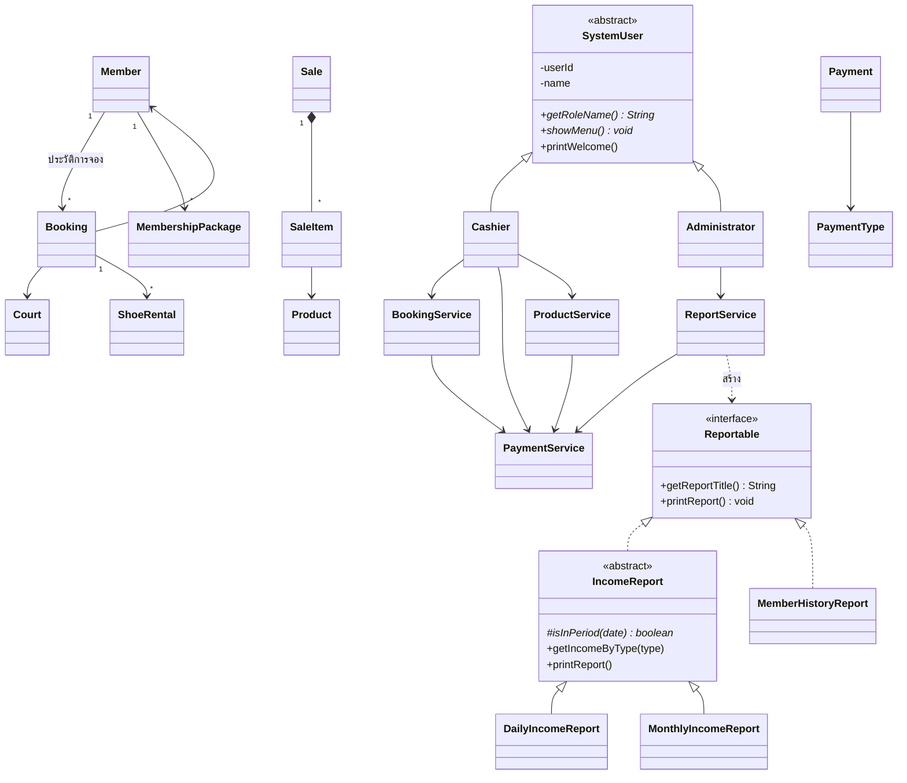

# ระบบจัดการการจองสนามแบดมินตัน (Java OOP: Console + GUI)

โปรเจกต์ตัวอย่างสำหรับเรียน Java OOP: จองสนาม 12 สนาม, สมาชิก, แพ็กเกจชั่วโมง, ส่วนลดชั่วโมงที่ 20,
เช่ารองเท้า, ขายอุปกรณ์ และรายงานรายได้รายวัน/รายเดือน ใช้เฉพาะ Java มาตรฐาน (ไม่มีฐานข้อมูล ไม่มี framework)

มี 2 หน้าตาให้เลือกใช้ ซึ่งใช้ Service และกฎทางธุรกิจชุดเดียวกัน:
- **GUI (Java Swing)** — รัน `com.example.badminton.gui.BadmintonApp`
- **Console** — รัน `com.example.badminton.Main`

---

## 1. สรุปความต้องการ (Requirement Analysis)

| หัวข้อ | สรุป |
|---|---|
| สนาม | 12 สนาม ราคา 180 บาท/ชม. |
| เวลาทำการ | จ-ศ 13:00-21:00 / ส-อา และวันหยุดนักขัตฤกษ์ 10:00-20:00 |
| การจอง | เฉพาะสมาชิก, ห้ามนอกเวลา, ห้ามจองซ้อนสนามเดียวกัน, ต่างสนามเวลาเดียวกันได้ |
| แพ็กเกจ | 2,600 บาท ได้ 15 ชม. หักชั่วโมงเมื่อใช้ ห้ามติดลบ ไม่เก็บค่าสนามซ้ำ |
| ส่วนลด | ชั่วโมงสะสมที่ 20 จ่าย 30% = 54 บาท |
| เช่ารองเท้า | 50 บาท/คู่/วันที่จอง |
| ขายอุปกรณ์ | ไม้แบด ลูกขนไก่ รองเท้า ฯลฯ (กำหนดราคาเอง) |
| ผู้ใช้ | แคชเชียร์ (จอง/ค้นหา/รับเงิน/ขาย) และ ผู้ดูแลระบบ (ประวัติ/รายงาน/ตรวจการจอง) |
| รายงาน | รายวัน/รายเดือน แยกหมวด: ค่าสนาม, แพ็กเกจ, เช่ารองเท้า, ขายอุปกรณ์ |

### สมมติฐาน (ข้อที่โจทย์ไม่ได้ระบุชัด)
1. **จองเป็นชั่วโมงเต็ม** เริ่มตรงชั่วโมง (เช่น 13:00) ครั้งละ n ชั่วโมง
2. **ห้ามจองย้อนหลัง** (วันที่ต้องเป็นวันนี้หรืออนาคต)
3. **ชั่วโมงสะสมเพื่อส่วนลดนับเฉพาะชั่วโมงที่จ่ายเงินปกติ** ชั่วโมงที่ใช้แพ็กเกจไม่นับ
4. **ส่วนลดให้ทุกรอบ 20 ชั่วโมง** (ชั่วโมงที่ 20, 40, 60, ...) ถ้าต้องการให้ได้ครั้งเดียว แก้ `PaymentService.isDiscountHour()` เป็น `hourNumber == 20`
5. **การจองแบบใช้แพ็กเกจต้องใช้แพ็กเกจทั้งการจอง** ถ้าชั่วโมงไม่พอจะไม่ให้จอง (ให้ลดชั่วโมงหรือจ่ายปกติ)
6. **เช่ารองเท้า 1 การจอง = 1 วัน** ค่าเช่า = คู่ × 1 วัน × 50
7. **รายได้นับตามวันที่รับเงินจริง** (ไม่ใช่วันที่ใช้สนาม) และการจองด้วยแพ็กเกจไม่สร้างรายได้ใหม่
8. **วันหยุดนักขัตฤกษ์** มีรายการตัวอย่างปี 2026 ให้แล้ว ผู้ดูแลระบบเพิ่มได้ในเมนู
9. **การเข้าสู่ระบบเป็นแบบจำลอง** (เลือกบทบาทจากเมนู ไม่มีรหัสผ่าน)
10. ข้อมูลเก็บในหน่วยความจำ ปิดโปรแกรมแล้วหาย (มีข้อมูลตัวอย่างโหลดให้ทุกครั้ง)

---

## 2. โครงสร้าง OOP



| แนวคิด | อยู่ที่ไหนในโค้ด |
|---|---|
| **Encapsulation** | ฟิลด์ทุกคลาสเป็น `private`; ตรวจข้อมูลใน setter/constructor เช่น `Member.setPhoneNumber()`, `Product.setUnitPrice()`, `MembershipPackage.useHours()` (ห้ามชั่วโมงติดลบ) |
| **Inheritance** | `Cashier`, `Administrator` extends `SystemUser`; `DailyIncomeReport`, `MonthlyIncomeReport` extends `IncomeReport` |
| **Abstract class** | `SystemUser` (ข้อมูล/พฤติกรรมร่วมของพนักงาน), `IncomeReport` (สูตรรายงานรายได้ร่วม) |
| **Interface** | `Reportable` implements โดย `IncomeReport` และ `MemberHistoryReport` |
| **Polymorphism** | `Main.openUserMenu(SystemUser user)` → `user.showMenu()` ได้เมนูต่างกัน; `ReportService.showReport(Reportable r)` → `r.printReport()` ใช้ได้กับรายงานทุกแบบ; `IncomeReport.printReport()` เรียก `isInPeriod()` ที่ลูกแต่ละตัว override |

---

## 3. โครงสร้างโปรเจกต์

```
src/main/java/com/example/badminton/
├── BadmintonSystem.java       สร้าง Service ทั้งหมด + ผู้ใช้ระบบ + ข้อมูลตัวอย่าง (ใช้ร่วมกันทั้ง Console และ GUI)
├── Main.java                  จุดเริ่มโปรแกรมแบบ Console + เมนูหลัก
├── model/                     ข้อมูลหลักของระบบ
│   ├── Member.java  Court.java  Booking.java  MembershipPackage.java
│   ├── ShoeRental.java  Product.java  Sale.java  SaleItem.java
│   └── Payment.java  PaymentType.java
├── service/                   กฎทางธุรกิจ + เก็บข้อมูล (ArrayList)
│   ├── MemberService.java  BookingService.java  PaymentService.java
│   └── ProductService.java  ReportService.java
├── report/                    รายงาน (interface + abstract class)
│   ├── Reportable.java  IncomeReport.java
│   └── DailyIncomeReport.java  MonthlyIncomeReport.java  MemberHistoryReport.java
├── user/                      ผู้ใช้ระบบ
│   ├── SystemUser.java  Cashier.java  Administrator.java
├── util/
│   ├── InputHelper.java       รับข้อมูลจากคีย์บอร์ดแบบไม่ crash (Console)
│   └── FormatHelper.java      แสดงวันที่ไทย/จำนวนเงิน
└── gui/                       หน้าตาแบบหน้าต่าง (Java Swing)
    ├── BadmintonApp.java      จุดเริ่มโปรแกรมแบบ GUI
    ├── MainFrame.java         หน้าต่างหลัก (แถบหัว + สลับหน้า login / แคชเชียร์ / ผู้ดูแลระบบ)
    ├── LoginPanel.java        หน้าแรก: เลือกบทบาท / สมัครสมาชิก
    ├── RegisterMemberDialog.java  หน้าต่างสมัครสมาชิก
    ├── BookingSearchPanel.java    ค้นหา/ดูการจอง (ใช้ทั้งแคชเชียร์และผู้ดูแล)
    ├── MemberPanel.java           รายชื่อสมาชิก (ใช้ทั้งแคชเชียร์และผู้ดูแล)
    ├── RoleTabbedPane.java  Refreshable.java  DateField.java  UiHelper.java   ตัวช่วยด้านหน้าจอ
    ├── cashier/               BookingPanel (ฟอร์มจอง) + CourtSchedulePanel (ตารางสนาม)
    │                          PackagePanel  ShoeRentalPanel  SalesPanel
    └── admin/                 IncomeReportPanel  MemberHistoryPanel  PaymentsPanel
                               ProductManagePanel  HolidayPanel
```

> หน้าจอ GUI ไม่ได้คำนวณราคาหรือตรวจกฎเอง ทุกอย่างเรียกผ่าน Service เดียวกับ Console
> (เช่น `BookingService.validateBooking()`, `PaymentService.calculateCourtFee()`) กฎทางธุรกิจจึงอยู่ที่เดียว
>
> ไฟล์ตัวอย่าง JavaFX ที่ IntelliJ สร้างมาตอนแรกถูกลบออกแล้ว ส่วน GUI ใช้ Swing ซึ่งมากับ JDK อยู่แล้ว
> (`module-info.java` มีแค่ `requires java.desktop;`) ไม่ต้องติดตั้ง dependency เพิ่ม

---

## 4. วิธีรันใน IntelliJ IDEA

1. เปิดโฟลเดอร์ `Badminton` ใน IntelliJ (เป็นโปรเจกต์ Maven ให้รอ IntelliJ โหลด dependency เสร็จ)
2. ตรวจ **File → Project Structure → SDK** เป็น JDK 25 (มีอยู่ที่ `~/.jdks/openjdk-25.0.1`)
3. **แบบ GUI:** เปิด `src/main/java/com/example/badminton/gui/BadmintonApp.java`
   แล้วคลิก ▶ สีเขียวข้าง `public static void main` → **Run 'BadmintonApp.main()'**
4. **แบบ Console:** เปิด `src/main/java/com/example/badminton/Main.java` แล้วกด ▶ เช่นกัน
   (ใช้งานผ่านหน้าต่าง Run ด้านล่าง พิมพ์ตัวเลขเมนูแล้วกด Enter)

### การใช้งาน GUI โดยย่อ
- **หน้าแรก:** กดเลือก "แคชเชียร์" หรือ "ผู้ดูแลระบบ" (จำลองการเข้าสู่ระบบ) หรือ "สมัครสมาชิก"
- **แคชเชียร์ → จองสนาม:** เลือกวันที่ (ปุ่ม `<` `>`) → กรอกรหัสสมาชิกแล้วกด "ตรวจสอบ"
  → คลิกช่องว่างในตารางสนามเพื่อเลือกสนามและเวลาเริ่ม → ปรับจำนวนชั่วโมง/รองเท้า/แพ็กเกจ
  → กล่อง "สรุปการจอง" คำนวณราคาให้ทันที (สีแดง = จองไม่ได้ พร้อมเหตุผล) → กรอกสลิป → "ยืนยันการจอง"
- **สีในตารางสนาม:** เขียว = ว่าง, แดงอ่อน = จองแล้ว, ส้ม = จองด้วยแพ็กเกจ, เทา = ปิด,
  เหลือง = ช่วงที่กำลังเลือก, แดงเข้ม = ช่วงที่เลือกชนการจองอื่นหรืออยู่นอกเวลา
- **แท็บอื่นของแคชเชียร์:** ค้นหาการจอง, แพ็กเกจชั่วโมง, เช่ารองเท้า, ขายอุปกรณ์ (ตะกร้าสินค้า), สมาชิก
- **ผู้ดูแลระบบ:** รายงานรายได้ (รายวัน/รายเดือน), ประวัติการจองของสมาชิก, การจองทั้งหมด,
  รายการรับเงิน, สมาชิก, จัดการสินค้า, วันหยุดนักขัตฤกษ์
- ทุกแท็บโหลดข้อมูลใหม่อัตโนมัติเมื่อเปิด จึงเห็นผลจากแท็บอื่นทันที (เช่น จองแล้วรายงานรายได้อัปเดต)

> ถ้าตัวอักษรไทยแสดงผิด: **Settings → Editor → File Encodings** ตั้งเป็น UTF-8 ทั้งหมด

### ข้อมูลตัวอย่างที่โหลดให้อัตโนมัติ
- **M001** สมชาย ใจดี (สมาชิกใหม่)
- **M002** สุดา รักกีฬา — สะสมแล้ว **18 ชม.** (จองสนาม 12 ไว้ 3 ครั้ง วันที่ +7, +8, +9 วันจากวันนี้ เวลา 13:00-19:00)
- **M003** วิชัย ตีแรง — มี **แพ็กเกจ 15 ชม.**
- สินค้า P01–P08 เช่น P01 ไม้แบดมาตรฐาน 1,200 / P03 ลูกขนไก่หลอด 650 / P05 รองเท้า (ขาย) 1,800
- รายได้ตัวอย่างของ "วันที่เปิดโปรแกรม": ค่าสนาม 3,240 + แพ็กเกจ 2,600 = **5,840 บาท**

---

## 5. ผลการตรวจสอบ (Verification)

คอมไพล์ด้วย JDK 25 ผ่าน และรันทดสอบด้วยข้อมูลนำเข้าแบบสคริปต์ครบทุกเมนู
(ทดสอบเมื่อวันอาทิตย์ 2026-10-11; 2026-10-12 = จันทร์, 2026-10-13 = วันหยุดนักขัตฤกษ์, 2026-10-17 = เสาร์)

## 6. Test Scenarios และผลที่คาดหวัง

ลำดับด้านล่างทำต่อเนื่องกันในการเปิดโปรแกรมครั้งเดียว (ผลจริงตรงกับที่ระบุทุกข้อ)

| # | ขั้นตอน (เมนู) | ข้อมูลนำเข้า | ผลที่คาดหวัง |
|---|---|---|---|
| 1 | หลัก 3 สมัครสมาชิก | ชื่อ `ทดสอบ ระบบ`, เบอร์ `abc` แล้ว `0811111111` | เบอร์ `abc` ถูกปฏิเสธ → ได้รหัส **M004** |
| 2 | แคชเชียร์ 1 จองวันธรรมดา | M004, สนาม 1, 2026-10-12, 13, 2 ชม., รองเท้า 2 คู่ | ค่าสนาม 360 + รองเท้า 100 = **460 บาท** (B004) |
| 5 | จองซ้อน | M004, สนาม 1, 2026-10-12, 14, 1 ชม. | **ปฏิเสธ**: สนาม 1 ถูกจองแล้ว |
| 6 | สนามอื่นเวลาเดียวกัน | M004, สนาม 2, 2026-10-12, 14, 1 ชม. | **สำเร็จ** 180 บาท (B005) |
| 4 | นอกเวลา (วันธรรมดา) | สนาม 3, 2026-10-12, เริ่ม 10 | **ปฏิเสธ**: เปิด 13:00-21:00 |
| 3 | วันเสาร์ | สนาม 3, 2026-10-17, 10, 2 ชม. | **สำเร็จ** 360 บาท (เปิด 10:00-20:00) |
| 4b | เกินเวลาปิดวันเสาร์ | 2026-10-17, เริ่ม 19, 2 ชม. | **ปฏิเสธ**: 19:00-21:00 เกิน 20:00 |
| 3b | วันหยุดนักขัตฤกษ์ | M001, สนาม 4, 2026-10-13, 10, 1 ชม. | **สำเร็จ** (วันอังคารแต่ใช้เวลาวันหยุด) |
| - | จองย้อนหลัง / ไม่ใช่สมาชิก | 2026-10-01 / M999 | **ปฏิเสธ** ทั้งสองกรณี |
| 10 | ส่วนลดชั่วโมงที่ 20 | M002 (สะสม 18), สนาม 5, 2026-10-12, 13, 3 ชม. | ชม. 19, 20, 21 = 180 + **54** + 180 = **414 บาท** สะสมเป็น 21 |
| 8 | ใช้แพ็กเกจ | M003, สนาม 6, 2026-10-12, 13, 4 ชม., ใช้แพ็กเกจ y | ค่าสนาม 0, ไม่ถามสลิป, คงเหลือ **15 → 11** |
| 8b | ใช้แพ็กเกจอีกครั้ง | M003, สนาม 7, 13, 8 ชม. | คงเหลือ **11 → 3** |
| 9 | แพ็กเกจไม่พอ | M003, สนาม 8, 13, 4 ชม. | **ปฏิเสธ**: เหลือ 3 ชม. แต่ต้องการ 4 |
| 7 | ซื้อแพ็กเกจ (เมนู 4) | M004 | PK002, รายได้ 2,600, คงเหลือ 15 ชม. |
| 11 | เช่ารองเท้า (เมนู 6) | B009, 3 คู่ | 3 × 50 = **150 บาท** |
| 12 | ขายอุปกรณ์ (เมนู 7) | P03×2, P05×1, P99 (ไม่มี), P01 จำนวน -1 แล้ว 1 | P99 และ -1 ถูกปฏิเสธ; 1,300 + 1,800 + 1,200 = **4,300 บาท** |
| 13 | ค้นหา (เมนู 3) | รหัส B004 / รหัสสมาชิก M003 / ชื่อ `สุดา` | แสดงรายละเอียด / 2 รายการ / 3 รายการ |
| 14 | ผู้ดูแล 1 ประวัติ | M002 | 4 รายการ, สะสม 21 ชม., ส่วนลดถัดไปชั่วโมงที่ 40 |
| 15 | ผู้ดูแล 2 รายวัน | 2026-10-11 | ค่าสนาม 4,734 / แพ็กเกจ 5,200 / รองเท้า 250 / อุปกรณ์ 4,300 / **รวม 14,484 บาท** |
| 16 | ผู้ดูแล 3 รายเดือน | 2026-10 | ยอดเท่ากับรายวัน (ทุกรายการอยู่ในเดือนนี้) |
| 17 | การใช้แพ็กเกจไม่นับรายได้ซ้ำ | ดูรายงานข้อ 15 | ใช้แพ็กเกจไป 12 ชม. แต่ค่าเช่าสนามไม่เพิ่ม และหมวดแพ็กเกจนับเฉพาะตอนขาย (2 × 2,600) |
| 18 | OOP | ดูหัวข้อ 2 | abstract class / interface / inheritance / polymorphism ถูกใช้จริงในการทำงาน |

**ที่มาของยอดค่าสนาม 4,734:** ตัวอย่าง 3,240 + B004 360 + B005 180 + B006 360 + B007 180 + B008 414

**ข้อผิดพลาดการพิมพ์:** พิมพ์ตัวอักษรแทนตัวเลข, ตัวเลขนอกช่วง, วันที่ผิดรูปแบบ → แสดงข้อความภาษาไทยและถามใหม่ ไม่ crash
(พิมพ์ปี พ.ศ. เช่น `2569-10-12` ระบบแปลงเป็น ค.ศ. ให้)

---

## 7. Requirement Checklist

| ความต้องการ | คลาส / เมธอด |
|---|---|
| 12 สนาม, 180 บาท/ชม. | `BookingService.TOTAL_COURTS`, `Court.STANDARD_PRICE_PER_HOUR` |
| เวลาทำการ จ-ศ / ส-อา / วันหยุด | `BookingService.getOpeningTime()`, `getClosingTime()`, `isWeekendOrHoliday()`, `addPublicHoliday()` |
| เลือกสนาม วันที่ เวลา | `Cashier.bookCourt()` |
| ห้ามนอกเวลา / ห้ามจองซ้อน / ต่างสนามได้ | `BookingService.validateBooking()`, `isCourtAvailable()`, `Booking.overlapsWith()` |
| ห้ามจองย้อนหลัง, ชั่วโมงไม่ถูกต้อง, สนามไม่ถูกต้อง | `BookingService.validateBooking()`, `InputHelper.readInt()` |
| เฉพาะสมาชิกจองได้ | `SystemUser.askForMember()`, `BookingService.createBooking()` |
| สมัครสมาชิก, รหัสไม่ซ้ำ | `Main.registerMember()`, `gui.RegisterMemberDialog`, `MemberService.registerMember()` |
| หน้าจอ GUI (Swing) ครบทุกฟังก์ชัน | `gui.BadmintonApp`, `gui.MainFrame`, แพ็กเกจ `gui.cashier` และ `gui.admin` |
| ข้อมูลสมาชิก (รหัส ชื่อ เบอร์) | `Member` |
| บทบาทแคชเชียร์ / ผู้ดูแล | `SystemUser` (abstract), `Cashier`, `Administrator` |
| ข้อมูลการจองครบ (รหัส สมาชิก สนาม วันที่ เวลา ค่าเช่า สลิป สถานะ) | `Booking` |
| คำนวณค่าสนามอัตโนมัติ | `PaymentService.calculateCourtFee()` |
| เก็บการจองใน collection | `BookingService.bookings` (ArrayList), `Member.bookings` |
| ค้นหาด้วยรหัสการจอง/รหัสสมาชิก/ชื่อ/วันที่ | `BookingService.findById()`, `searchByMemberId()`, `searchByMemberName()`, `searchByDate()`; `Cashier.searchBooking()` |
| บันทึกการชำระเงินและสลิป | `Payment`, `PaymentService.recordPayment()`, `payCourtFee()` |
| แพ็กเกจ 2,600 บาท / 15 ชม. | `MembershipPackage`, `PaymentService.sellPackage()`, `Cashier.buyPackage()` |
| หักชั่วโมงแพ็กเกจ ห้ามเกิน ห้ามติดลบ | `Member.usePackageHours()`, `MembershipPackage.useHours()`, `BookingService.createBooking()` |
| ตรวจชั่วโมงคงเหลือ | `Member.getRemainingPackageHours()`, `Cashier.checkPackageHours()` |
| จองด้วยแพ็กเกจไม่เก็บค่าสนามซ้ำ | `BookingService.createBooking()` (courtFee = 0), `PaymentService.payCourtFee()` (ไม่สร้าง Payment) |
| ส่วนลดชั่วโมงที่ 20 = 54 บาท, ไม่ซ้ำ | `PaymentService.isDiscountHour()`, `getDiscountedHourPrice()`, `calculateCourtFee()`, `Member.addQualifyingHours()` |
| เช่ารองเท้า 50 บาท/คู่/วัน | `ShoeRental`, `PaymentService.rentShoes()`, `Cashier.bookCourt()`, `Cashier.rentShoes()` |
| รวมค่ารองเท้าในยอดการจอง | `Booking.getShoeRentalFee()`, `getTotalAmount()` |
| ขายอุปกรณ์ (รหัส ชื่อ ราคา จำนวน ราคารวม) | `Product`, `SaleItem`, `Sale`, `ProductService.createSale()`, `Cashier.sellEquipment()` |
| แยกเช่ารองเท้า vs ขายรองเท้า | `ShoeRental` + `PaymentType.SHOE_RENTAL` vs `Product P05` + `PaymentType.EQUIPMENT_SALE` |
| ประวัติการจองของสมาชิก + ชั่วโมงสะสม | `MemberHistoryReport`, `Administrator.viewMemberHistory()` |
| รายงานรายวัน/รายเดือนแยกหมวด | `DailyIncomeReport`, `MonthlyIncomeReport`, `IncomeReport.printReport()` |
| นับรายได้จริง ไม่นับซ้ำ | `IncomeReport` (นับจาก Payment เท่านั้น), `PaymentService.isAlreadyPaid()` |
| ตรวจดูการจองทั้งหมด | `Administrator.viewAllBookings()`, `viewAllPayments()` |
| เมนูภาษาไทย / จัดการ input ผิด | `Main`, `Cashier.showMenu()`, `Administrator.showMenu()`, `InputHelper` |
| Encapsulation / Inheritance / Abstract / Interface / Polymorphism | ดูหัวข้อ 2 |
